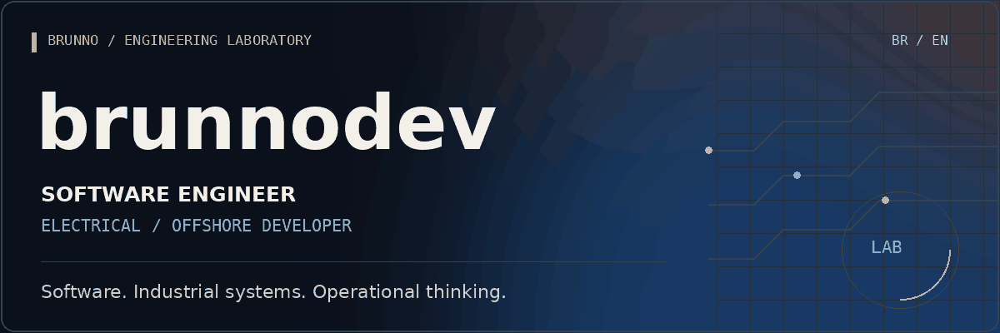
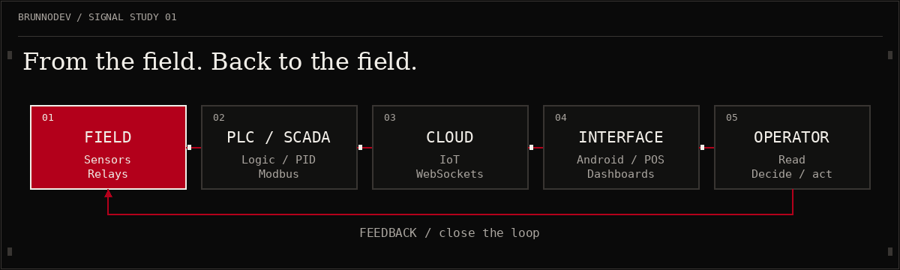
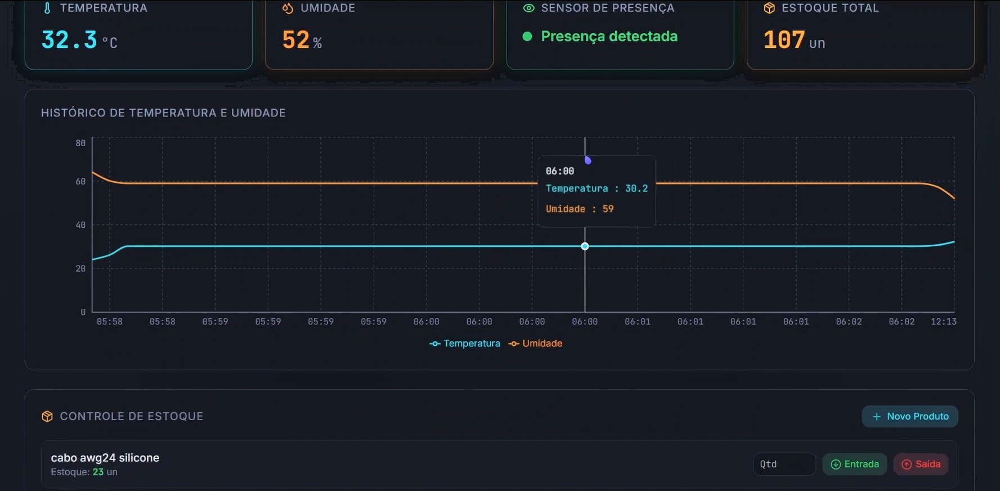
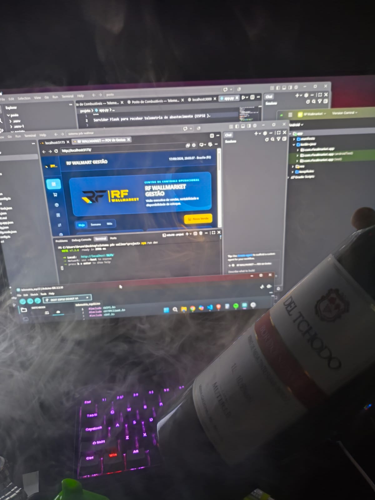
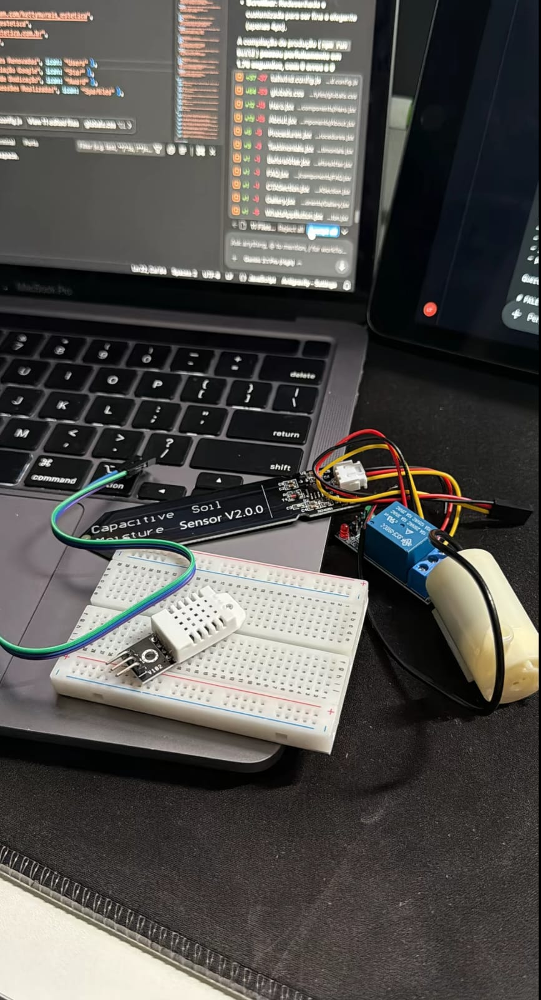

<picture>
  <source media="(prefers-reduced-motion: reduce)" srcset="assets/profile/lab-hero.png" />
  
</picture>

I build software around operational problems: developer workflows, industrial control, telemetry and field interfaces. My foundation is **C and Java**; my work connects **hardware, firmware, APIs and the people using them**.

**Full-stack · Cybersecurity · Industrial automation · Low-code**  
**Cambridge C2 English** · Brazil / international collaboration

[Enter the laboratory ↗](https://brunnodev.store/) · [LinkedIn](https://www.linkedin.com/in/brunnojob/) · [Contact](mailto:contato@brunnodev.store) · [Skills](#skills) · [Evidence](#evidence) · [Sponsors](#sponsors)

  <a href="https://rf-offshore.com/" title="RF Offshore — company website"><picture>
    <source media="(prefers-reduced-motion: reduce)" srcset="assets/profile/offshore-motion.png" />
    
  </picture></a>
  <a href="https://rfwallmarket.com/" title="RF WALLMARKET — company website"><picture>
    <source media="(prefers-reduced-motion: reduce)" srcset="assets/profile/wallmarket-motion.png" />
    
  </picture></a>

## Tools for the developer community

| Project | Problem → approach | Try it |
|---|---|---|
| **[PatchScope](https://github.com/brunnojob/patchscope)** | Large diffs → focused review checklists with file and line evidence. Browser, CLI and GitHub Actions. | [Review a diff ↗](https://brunnojob.github.io/patchscope/) |
| **[CIFuse](https://github.com/brunnojob/cifuse)** | Noisy CI logs → grouped failure signals, source context and investigation steps. Browser, CLI and GitHub Actions. | [Inspect a log ↗](https://brunnojob.github.io/cifuse/) |
| **[DevStart Lab](https://github.com/brunnojob/devstart-lab)** | Unsure where to begin → a programming roadmap, exercises and project ideas through the first pull request. | [Start learning ↗](https://brunnojob.github.io/devstart-lab/?lang=en) |
| **[RepoRelief](https://github.com/brunnojob/reporelief)** | Scattered maintenance work → a prioritized plan for documentation gaps, broken local links and missing test-file matches. Browser and CLI. | [Run an audit ↗](https://brunnojob.github.io/reporelief/) |
| **[RevScope](https://github.com/brunnojob/revscope)** | Too many reverse engineering tools → a searchable catalog with comparisons, official documentation and task-based workflows. | [Explore tools ↗](https://brunnojob.github.io/revscope/) |

PatchScope, CIFuse and RepoRelief process inputs locally with static heuristics. Their reports support review; they do not establish correctness, root cause or test coverage.

## Engineering toolkit

| Area | Skills |
|---|---|
| Languages | C / C17, Java, TypeScript, Python, C++, C#, Ruby, Swift, Kotlin, IEC 61131-3 Structured Text |
| Software & data | Full-stack, system design, API integration, banking APIs, databases, PostgreSQL, SQLite, security systems, cybersecurity, testing |
| Field & cloud | PLC, SCADA, HMI, signal control, Modbus, PID, Arduino, ESP32, sensor networks, IoT, telemetry, MQTT, WebSockets, AWS, Oracle Cloud IoT, Supabase |
| Product & operations | Mobile UX, Room, Android Keystore, local transactions, persistent synchronization queues, device states, field operations, Stone / Sunmi POS, QR payments, checkout, catalog, inventory, cash control, role-based operations |
| Collaboration | Project management, technical writing, documented architecture and technical decisions, Cambridge C2 English, numerical modeling (RK4) |

<b>Inspect implementations by language</b>

| Language / target | Source |
|---|---|
| C17 | [Durable archive client](https://github.com/brunnojob/vercel-home-telemetry-api/tree/main/clients/c) |
| C++ | [Concurrent task queue](https://github.com/brunnojob/cpp-safe-task-queue) |
| C# | [Supabase inventory API](https://github.com/brunnojob/csharp-pantry-api) |
| Java | [Balanced ledger](https://github.com/brunnojob/bank-crypto-ledger) |
| Kotlin | [Android inspections](https://github.com/brunnojob/android-offshore-field-console) |
| Swift | [Native inspection store](https://github.com/brunnojob/android-offshore-field-console/tree/main/ios) |
| Ruby | [Git collaboration auditor](https://github.com/brunnojob/pair-extraordinaire-badge) |
| IEC 61131-3 Structured Text / PLC | [Circuit exporter](https://github.com/brunnojob/eletrical-comands-and-teory) |
| SCADA | [Control studio](https://github.com/brunnojob/scada-code-studio) |

<b>From the field to the interface — architecture & working principles</b>

Sensors and relays feed PLC / SCADA logic, cloud telemetry and operator interfaces; operator decisions feed back into the process.

<picture>
  <source media="(max-width: 600px) and (prefers-reduced-motion: reduce)" srcset="assets/noir/signal-path-mobile.png" />
  <source media="(prefers-reduced-motion: reduce)" srcset="assets/noir/signal-path.png" />
  <source media="(max-width: 600px)" srcset="assets/noir/signal-path-mobile.gif" />
  
</picture>

Original motion study by Brunno Dev · [Still diagram](assets/noir/signal-path.png) · [Mobile still](assets/noir/signal-path-mobile.png)

| Focus | Work to inspect |
|---|---|
| Electrical commands & process visibility | [Circuit exporter](https://github.com/brunnojob/eletrical-comands-and-teory) · [SCADA studio](https://github.com/brunnojob/scada-code-studio) |
| Connected devices & real-time feedback | [C17 archive client](https://github.com/brunnojob/vercel-home-telemetry-api/tree/main/clients/c) · [Telemetry evidence](#evidence) |
| APIs, security boundaries & data models | [Balanced ledger](https://github.com/brunnojob/bank-crypto-ledger) · [Inventory API](https://github.com/brunnojob/csharp-pantry-api) · [Concurrent queue](https://github.com/brunnojob/cpp-safe-task-queue) |
| Touch-first field interfaces | [Android console](https://github.com/brunnojob/android-offshore-field-console) · [iOS inspection store](https://github.com/brunnojob/android-offshore-field-console/tree/main/ios) |
| Checkout & operator workflows | [Stone POS evidence](#evidence) |

I start with the signal, then the protocol, data model, interface and person using it. Read the signal before writing code; keep operator journeys clear; validate against the real process before shipping.

**Leadership:** RF Offshore — industrial, offshore and field operations. RF WALLMARKET — autonomous retail, infrastructure and operational technology.

## Evidence

[Recorded run](https://github.com/brunnojob/brunnojob/actions/runs/38018340176) · [Execution report](docs/proof/evidence.json) · [Execution index](docs/proof/INDEX.md) · [Project demonstrations](https://brunnojob.github.io/devstart-lab/proofs/?lang=en)

Execution records cover the listed scenarios and source commits. Screenshots below document project interfaces and bench work.

<b>RF Solutions × Stone — POS System</b>

 

  

<b>OFS — Offshore Fleet POB Platform</b>

 

  

<b>Arduino / ESP32 Telemetry</b>

 

**Device output — ESP32 serial monitor**

  

**Python bridge — MQTT messages received**

  

**Database — persisted sensor readings**

  

**Dashboard — temperature, humidity and inventory**

  

**Activity log — inventory movements and recent readings**

  

<b>Workbench & personal projects</b>

 

  
  
  

<b>Reproduce the recorded execution</b>

Run `python .proof/record.py` with the prerequisites in the [execution index](docs/proof/INDEX.md). Scenarios run repository code and check exit codes and expected output. CI publishes the `execution-proof` artifact with transcripts, input fingerprints and the source commit. The report identifies the tested version; the badge follows the latest workflow run.

## Beyond developer tools

Electrical control, embedded telemetry, mobile operations and retail systems live in the [project catalog](PROJECTS.md). Start with [SCADA Code Studio](https://github.com/brunnojob/scada-code-studio), [PID pressure control](https://github.com/brunnojob/pid-pressure-control) or [industrial IoT event handling](https://github.com/brunnojob/industrial-iot-sentinel).

[All repositories ↗](https://github.com/brunnojob?tab=repositories) · [Operations archive ↗](https://vercel-home-telemetry-api.vercel.app/laboratory.html)

## Sponsors

Support funds maintenance, reproducible examples and documentation. Thank you to the people supporting the lab.

  

<!-- sponsors:start -->
<table width="100%">
<tr><td align="center" valign="top"><a href="https://github.com/ineedfoundmyway"> <strong>@ineedfoundmyway</strong></a> PART OF THE STORY Thank you for supporting the lab.</td></tr>
</table>
<!-- sponsors:end -->

[GitHub Sponsors](https://github.com/sponsors/brunnojob) · [Donate via Stripe](https://donate.stripe.com/6oU8wQg9k9Hb8809CrfQI01) · [Buy Me a Coffee](https://buymeacoffee.com/brunnodev)

Public GitHub supporters are synchronized automatically. Private sponsorships stay private.

A thought behind the work

“Archimedes will be remembered when Aeschylus is forgotten, because languages die but mathematical ideas endure.” — G. H. Hardy

[Back to top](#top) · [brunnodev.store](https://brunnodev.store/) · Original source and documentation: [MIT](LICENSE). Third-party dependencies and media retain their terms.
