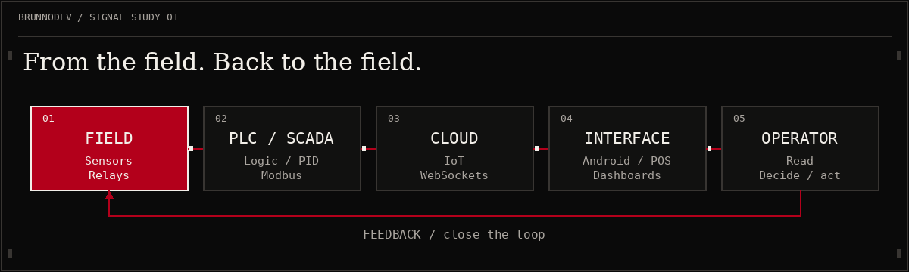
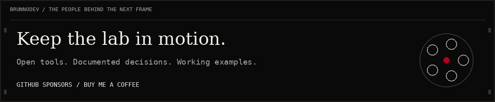

<div align="center">

<a href="https://brunnodev.store/">
  
</a>

<br/>

[](https://brunnodev.store/)
[](https://github.com/brunnojob/brunnojob/blob/main/PROJECTS.md)
[](https://github.com/brunnojob?tab=repositories)

<sub>choose your scene</sub>

[](#the-pact)
[](#signal-path)
[](#arsenal)
[](#two-faces)
[](#evidence)
[](#cast)
[](#proof)
[](#sponsors)

</div>


<a id="the-pact"></a>

## I. The Pact

```text
EXT. AN OPEN FIELD — DUSK

A beast with horns and a figure in white dance on the horizon.
Neither leads. Neither falls.

                                   NARRATOR (V.O.)
               Every system is that dance. On one side, the beast:
               voltage, noise, relays, legacy protocols, hardware
               that does not forgive. On the other, the grace: an
               operator's thumb on a screen, a checkout that closes,
               a dashboard that tells the truth at 3 a.m.

                                                           CUT TO:
```

I build the choreography between the two.

My starting point is programming logic in **C and Java**. I work outward from there: the protocol, the data model, the interface, then the person who has to use it. I choose a language for the job and leave the reasoning alongside the implementation.

**Architecture, journeys and technical decisions focused on operational results.**
SCADA, PLC, IoT, automation and signal reading for real processes.
I connect engineering thinking, digital product and operational context to turn messy requirements into usable systems.

> **A working laboratory by Brunno Dev.** Follow a signal, inspect the source, and open the evidence behind it.

<details>
<summary><b>Director's notes</b> <sub>(open)</sub></summary>
<br>

| # | Rule on set |
|---|---|
| 01 | Read the signal before writing the code. |
| 02 | If the operator needs a manual, the interface failed. |
| 03 | Nothing ships until it has run against the real process. |

</details>


<a id="signal-path"></a>

## II. Signal Path

<sub>From a wire in the field to a decision on a screen. Every reel below is one stretch of this path.</sub>

<picture>
  <source media="(max-width: 600px) and (prefers-reduced-motion: reduce)" srcset="assets/noir/signal-path-mobile.png" />
  <source media="(prefers-reduced-motion: reduce)" srcset="assets/noir/signal-path.png" />
  <source media="(max-width: 600px)" srcset="assets/noir/signal-path-mobile.gif" />
  
</picture>

<sub>Original motion study by Brunno Dev · conceptual flow · [Still diagram](assets/noir/signal-path.png) · [Mobile still](assets/noir/signal-path-mobile.png)</sub>

### Choose a signal to follow

| Start with | Follow the scene | Inspect the work |
|---|---|---|
| A relay, a sensor, a process | [01 / Industrial logic](#reel-01) | [SCADA Code Studio](https://github.com/brunnojob/scada-code-studio) |
| A device sending readings | [02 / Telemetry](#reel-02) | [Bench-to-dashboard evidence](#evidence) |
| A request crossing a boundary | [03 / Architecture](#reel-03) | [Balanced ledger](https://github.com/brunnojob/bank-crypto-ledger) |
| An operator in the field | [04 / Mobile interfaces](#reel-04) | [Android field console](https://github.com/brunnojob/android-offshore-field-console) |
| A checkout under pressure | [05 / POS systems](#reel-05) | [Stone POS evidence](#evidence) |

<sub>Open each reel below for context, technologies and source code.</sub>

<a id="reel-01"></a>

<details>
<summary><b>REEL 01 — Automation & industrial logic</b> · <i>the beast wakes up</i></summary>
<br>

```text
INT. CONTROL ROOM — NIGHT
A relay clicks. A PLC answers. The process becomes visible.
```

Electrical commands, PLC/SCADA thinking and process visibility.

**PLC / SCADA / SIGNAL CONTROL / MODBUS / PID**

▸ On screen: [Circuit exporter](https://github.com/brunnojob/eletrical-comands-and-teory) · [SCADA control studio](https://github.com/brunnojob/scada-code-studio)

</details>

<a id="reel-02"></a>

<details>
<summary><b>REEL 02 — IoT & telemetry</b> · <i>the field starts talking</i></summary>
<br>

```text
EXT. ANYWHERE — CONTINUOUS
A sensor whispers. The cloud listens. A chart moves in real time.
```

Sensors, connected devices, cloud signals and real-time product feedback.

**ARDUINO / CLOUD IoT / TELEMETRY / WEBSOCKETS / SENSOR NETWORKS**

▸ On screen: [Durable archive client (C17)](https://github.com/brunnojob/vercel-home-telemetry-api/tree/main/clients/c) · [Arduino telemetry evidence](#evidence)

</details>

<a id="reel-03"></a>

<details>
<summary><b>REEL 03 — System architecture</b> · <i>the rules of the house</i></summary>
<br>

```text
INT. THE VAULT — DAY
Every request has a door. Every door has a lock.
```

APIs, integrations, security boundaries and sustainable technical decisions.

**BANK APIs / SECURITY SYSTEMS / DATABASES / AWS / SYSTEM DESIGN**

▸ On screen: [Balanced ledger](https://github.com/brunnojob/bank-crypto-ledger) · [Supabase inventory API](https://github.com/brunnojob/csharp-pantry-api) · [Concurrent task queue](https://github.com/brunnojob/cpp-safe-task-queue)

</details>

<a id="reel-04"></a>

<details>
<summary><b>REEL 04 — Android field interfaces</b> · <i>gloves on, screen on</i></summary>
<br>

```text
EXT. OFFSHORE DECK — WIND
An operator taps once. The inspection is saved. No one waits.
```

Touch-first surfaces for mobile operators and hardware-aware workflows.

**KOTLIN / MOBILE UX / DEVICE STATES / FIELD OPERATIONS**

▸ On screen: [Android offshore field console](https://github.com/brunnojob/android-offshore-field-console) · [Native iOS inspection store](https://github.com/brunnojob/android-offshore-field-console/tree/main/ios)

</details>

<a id="reel-05"></a>

<details>
<summary><b>REEL 05 — POS & payment systems</b> · <i>the money scene</i></summary>
<br>

```text
INT. STORE COUNTER — RUSH HOUR
Card in. QR on screen. Stock updated. Cash drawer reconciled.
```

Checkout, catalog, inventory, cash control and role-based operations.

**STONE / SUNMI / POS / QR / OPERATOR UX**

▸ On screen: [RF Solutions × Stone POS evidence](#evidence)

</details>


<a id="arsenal"></a>

## III. Arsenal

<div align="center">

<sub>LANGUAGES I SPEAK TO MACHINES</sub><br/>


<sub>THE CRAFT</sub><br/>


<sub>THE BEAST — FIELD & CLOUD</sub><br/>


<sub>THE GRACE — BEYOND CODE</sub><br/>


</div>


<a id="two-faces"></a>

## IV. Two Faces

<p align="center">
  
</p>

| Company | Role | Operating focus |
|---|---|---|
| [RF Offshore](https://rf-offshore.com/) | **CEO** | Industrial, offshore and field operations |
| [RF WALLMARKET](https://rfwallmarket.com/) | **CEO** | Autonomous retail, infrastructure and operational technology |


<a id="evidence"></a>

## V. Evidence Locker

<sub>Project screenshots and bench photos. Open a case to view the original images.</sub>

<details>
<summary><b>CASE #01 — RF Solutions × Stone — POS System</b></summary>
<br>
<p align="center">
  <a href="assets/projects/stone-pos-system.png"></a>
</p>
</details>

<details>
<summary><b>CASE #02 — OFS — Offshore Fleet POB Platform</b></summary>
<br>
<p align="center">
  <a href="assets/projects/ofs-fleet-dashboard.jpg"></a>
</p>
</details>

<details>
<summary><b>CASE #03 — Arduino / ESP32 Telemetry</b></summary>
<br>

**Device output — ESP32 serial monitor**

<p align="center">
  <a href="assets/projects/iot-esp32-serial.jpg"></a>
</p>

**Python bridge — MQTT messages received**

<p align="center">
  <a href="assets/projects/iot-python-mqtt.jpg"></a>
</p>

**Database — persisted sensor readings**

<p align="center">
  <a href="assets/projects/iot-supabase-readings.jpg"></a>
</p>

**Dashboard — temperature, humidity and inventory**

<p align="center">
  <a href="assets/projects/iot-dashboard.jpg"></a>
</p>

**Activity log — inventory movements and recent readings**

<p align="center">
  <a href="assets/projects/iot-audit-log.jpg"></a>
</p>
</details>

<details>
<summary><b>CASE #04 — Just for Fun</b> · <i>off the record</i></summary>
<br>
<p align="center">
  <a href="assets/projects/just-for-fun-1.jpeg"></a>
  <a href="assets/projects/just-for-fun-2.jpeg"></a>
  <a href="assets/projects/just-for-fun-3.jpeg"></a>
</p>
</details>

<a id="projects"></a>

### Projects

<p align="center">
  <a href="https://github.com/brunnojob/brunnojob/blob/main/PROJECTS.md"></a>
  <a href="https://github.com/brunnojob?tab=repositories"></a>
</p>


<a id="cast"></a>

## VI. Cast & Credits

<p align="center">
  
</p>

<details open>
<summary><b>Cast sheet — native implementations</b> <sub>(click a role to watch the scene)</sub></summary>
<br>

| Actor · language / target | Role · working source |
|---|---|
| C17 | [Durable archive client](https://github.com/brunnojob/vercel-home-telemetry-api/tree/main/clients/c) |
| C++ | [Concurrent task queue](https://github.com/brunnojob/cpp-safe-task-queue) |
| C# | [Supabase inventory API](https://github.com/brunnojob/csharp-pantry-api) |
| Java | [Balanced ledger](https://github.com/brunnojob/bank-crypto-ledger) |
| Kotlin | [Android inspections](https://github.com/brunnojob/android-offshore-field-console) |
| Swift | [Native inspection store](https://github.com/brunnojob/android-offshore-field-console/tree/main/ios) |
| Ruby | [Git collaboration auditor](https://github.com/brunnojob/pair-extraordinaire-badge) |
| IEC 61131-3 Structured Text / PLC | [Circuit exporter](https://github.com/brunnojob/eletrical-comands-and-teory) |
| SCADA | [Control studio](https://github.com/brunnojob/scada-code-studio) |

</details>


<a id="proof"></a>

## VII. Proof of Life

<sub>Recorded execution evidence for the scenarios listed in the index. Check the source commit and prerequisites before reproducing a run.</sub>

[](https://github.com/brunnojob/brunnojob/actions/workflows/proof.yml)

[Verified run](https://github.com/brunnojob/brunnojob/actions/runs/38018340176) · [Execution report](https://github.com/brunnojob/brunnojob/blob/main/docs/proof/evidence.json) · [Verified execution index](https://github.com/brunnojob/brunnojob/blob/main/docs/proof/INDEX.md)

<details>
<summary><b>How to reproduce the take</b></summary>
<br>

Run `python .proof/record.py` with the prerequisites listed in the execution index. The scenarios execute repository code and verify exit codes and expected output. CI publishes `execution-proof` with the transcript, input fingerprints and source commit. The downloadable report identifies the exact tested version; the workflow badge tracks the latest run.

</details>


<a id="sponsors"></a>

## VIII. Sponsors

<a href="https://github.com/sponsors/brunnojob">
  
</a>

I build around a simple loop: investigate a real problem, make the implementation inspectable, and document what it takes to run it. Sponsorship helps me keep that work moving.

<p align="center">
  <a href="https://github.com/sponsors/brunnojob"></a>
  <a href="https://buymeacoffee.com/brunnodev"></a>
</p>

### The people behind the next frame

<!-- sponsors:start -->
<table width="100%">
<tr><td align="center" valign="top"><a href="https://github.com/ineedfoundmyway"><br /><strong>@ineedfoundmyway</strong></a><br /><sub>PART OF THE STORY</sub><br /><sub>Thank you for supporting the lab.</sub></td></tr>
</table>
<!-- sponsors:end -->

### What your support helps sustain

| In the lab | For the people using it |
|---|---|
| Maintenance and troubleshooting | Projects that remain useful beyond the first release |
| Reproducible examples and documentation | A clearer path from reading the source to running it |
| New tools and technical experiments | More decisions, tradeoffs and results shared in the open |

<details>
<summary><b>Sponsor access / support and collaboration</b></summary>

Verified sponsors can discuss code reviews, troubleshooting, project guidance and collaboration ideas. Access instructions are provided privately in the GitHub Sponsors welcome message; refer to the selected tier for its terms.

Buy Me a Coffee contributions use separate verification. Please do not post payment details or private project information in public issues.

</details>

<sub>Public GitHub supporters are synchronized by the scheduled workflow. Private sponsorships are not displayed. [Sponsor options](https://github.com/sponsors/brunnojob) · [Explore the work first](PROJECTS.md)</sub>

<br/>

<div align="center">

<a href="https://brunnodev.store/">
  
</a>

**BUILD SYSTEMS. READ SIGNALS. SHIP OPERATIONS.**

[Back to the opening](#the-pact) · [Follow a signal](#signal-path) · [Support the next frame](#sponsors)

[](https://brunnodev.store/)
[](https://github.com/brunnojob/brunnojob/blob/main/PROJECTS.md)

<sub>Original source and documentation are MIT licensed; see [LICENSE](LICENSE). Third-party dependencies and media retain their respective terms. Maintained by [Brunno Dev](https://brunnodev.store).</sub>

</div>

