

<a href="https://www.brunnodev.store/">
  <picture>
    <source media="(max-width: 600px) and (prefers-reduced-motion: reduce)" srcset="assets/profile/profile-overview-mobile.png" />
    <source media="(prefers-reduced-motion: reduce)" srcset="assets/profile/profile-overview.png" />
    <source media="(max-width: 600px)" srcset="assets/profile/profile-overview-mobile.gif" />
    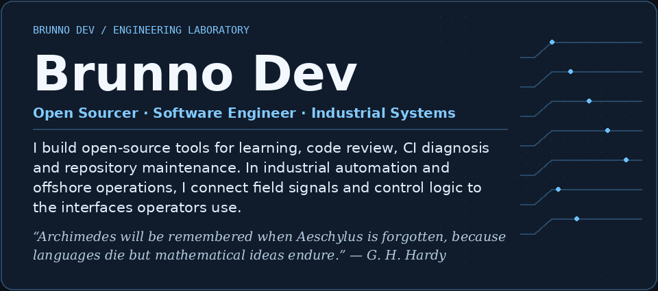
  </picture>
</a>

## Software Engineer · Industrial Systems · Open Source

I build software for developer workflows and industrial operations, connecting field data, control systems, APIs and practical user interfaces. My work spans C and Java, CI diagnosis, code review, repository tooling, telemetry and autonomous retail.

I lead **RF Offshore** and **RF WALLMARKET**, bringing engineering and operational experience together across offshore, industrial and retail environments. My portfolio includes working demos, source code, architecture notes and execution evidence.

**Core strengths:** C / C17 · Java · TypeScript · Python · PLC / SCADA · IoT telemetry · API and data modeling · security-minded engineering · technical leadership

[Portfolio & laboratory](https://www.brunnodev.store/) · [LinkedIn](https://www.linkedin.com/in/brunnojob/) · [Contact](mailto:contato@brunnodev.store) · [Live demos](#open-source-projects) · [Execution evidence](#evidence)

## Open-source projects

<b>Explore all six projects and previews</b>

### DevStart Lab

Learn programming through a roadmap, hands-on exercises and a path to your first GitHub pull request.

**[Start learning](https://brunnojob.github.io/devstart-lab/?lang=en)** · [Source](https://github.com/brunnojob/devstart-lab) · [Português](https://brunnojob.github.io/devstart-lab/?lang=pt)

### PatchScope

Turn a large diff into a review checklist with file and line references. Available in the browser, CLI and GitHub Actions.

**[Review a diff](https://brunnojob.github.io/patchscope/)** · [Source](https://github.com/brunnojob/patchscope) · [Watch the 18-second walkthrough](https://brunnojob.github.io/patchscope/docs/launch/demo.html)

### CIFuse

Group CI failures and trace them to the relevant log lines, source context and investigation steps.

**[Inspect a CI log](https://brunnojob.github.io/cifuse/)** · [Source](https://github.com/brunnojob/cifuse)

### RepoRelief

Prioritize repository maintenance across documentation, broken local links and missing test-file matches.

**[Run a repository audit](https://brunnojob.github.io/reporelief/)** · [Source](https://github.com/brunnojob/reporelief)

### RevScope

Compare reverse engineering tools in a searchable catalog with links to official documentation.

**[Explore the catalog](https://brunnojob.github.io/revscope/)** · [Source](https://github.com/brunnojob/revscope)

### SCADA Code Studio

Explore industrial control logic in a browser and inspect recorded execution examples.

**[Open the studio](https://brunnojob.github.io/scada-code-studio/)** · [Source](https://github.com/brunnojob/scada-code-studio)

## Engineering leadership

I lead RF Offshore and RF WALLMARKET. My work spans offshore field operations, industrial systems and autonomous retail infrastructure.

  <a href="https://rf-offshore.com/" title="RF Offshore — company website"><picture>
    <source media="(prefers-reduced-motion: reduce)" srcset="assets/profile/offshore-motion.png" />
    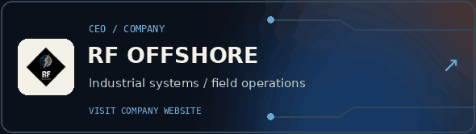
  </picture></a>
  <a href="https://rfwallmarket.com/" title="RF WALLMARKET — company website"><picture>
    <source media="(prefers-reduced-motion: reduce)" srcset="assets/profile/wallmarket-motion.png" />
    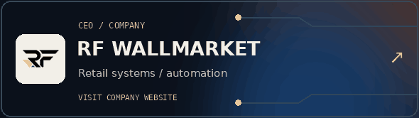
  </picture></a>

## Engineering toolkit

<b>Explore the engineering toolkit</b>

| Area | Skills |
|---|---|
| Languages | C / C17, Java, TypeScript, Python, C++, C#, Ruby, Swift, Kotlin, IEC 61131-3 Structured Text |
| Software & data | Full-stack, system design, API integration, banking APIs, databases, PostgreSQL, SQLite, security systems, cybersecurity, testing |
| Field & cloud | PLC, SCADA, HMI, signal control, Modbus, PID, Arduino, ESP32, sensor networks, IoT, telemetry, MQTT, WebSockets, AWS, Oracle Cloud IoT, Supabase |
| Product & operations | Mobile UX, Room, Android Keystore, local transactions, persistent synchronization queues, device states, field operations, Stone / Sunmi POS, QR payments, checkout, catalog, inventory, cash control, role-based operations |
| Collaboration | Project management, technical writing, documented architecture and technical decisions, Cambridge C2 English, numerical modeling (RK4) |

<b>From the field to the interface — architecture & working principles</b>

Sensors and relays feed PLC / SCADA logic, cloud telemetry and operator interfaces; operator decisions feed back into the process.

<picture>
  <source media="(max-width: 600px) and (prefers-reduced-motion: reduce)" srcset="assets/noir/signal-path-mobile-blue.png" />
  <source media="(prefers-reduced-motion: reduce)" srcset="assets/noir/signal-path-blue.png" />
  <source media="(max-width: 600px)" srcset="assets/noir/signal-path-mobile-blue.gif" />
  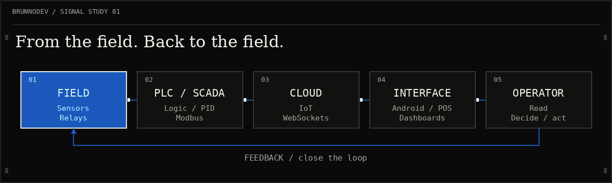
</picture>

Original motion study by Brunno Dev · [Still diagram](assets/noir/signal-path-blue.png) · [Mobile still](assets/noir/signal-path-mobile-blue.png)

| Focus | Work to inspect |
|---|---|
| Electrical commands & process visibility | [Circuit exporter](https://github.com/brunnojob/eletrical-comands-and-teory) · [SCADA studio](https://github.com/brunnojob/scada-code-studio) |
| Connected devices & real-time feedback | [C17 archive client](https://github.com/brunnojob/vercel-home-telemetry-api/tree/main/clients/c) · [Telemetry evidence](#evidence) |
| APIs, security boundaries & data models | [Balanced ledger](https://github.com/brunnojob/bank-crypto-ledger) · [Inventory API](https://github.com/brunnojob/csharp-pantry-api) · [Concurrent queue](https://github.com/brunnojob/cpp-safe-task-queue) |
| Touch-first field interfaces | [Android console](https://github.com/brunnojob/android-offshore-field-console) · [iOS inspection store](https://github.com/brunnojob/android-offshore-field-console/tree/main/ios) |
| Checkout & operator workflows | [Stone POS evidence](#evidence) |

I start with the signal, then the protocol, data model, interface and person using it. Read the signal before writing code; keep operator journeys clear; validate against the real process before shipping.

**Leadership:** RF Offshore — industrial, offshore and field operations. RF WALLMARKET — autonomous retail, infrastructure and operational technology.

## Execution evidence

<b>Explore field systems and workbench previews</b>

### RF Solutions × Stone — POS System

  <a href="assets/projects/stone-pos-system.png">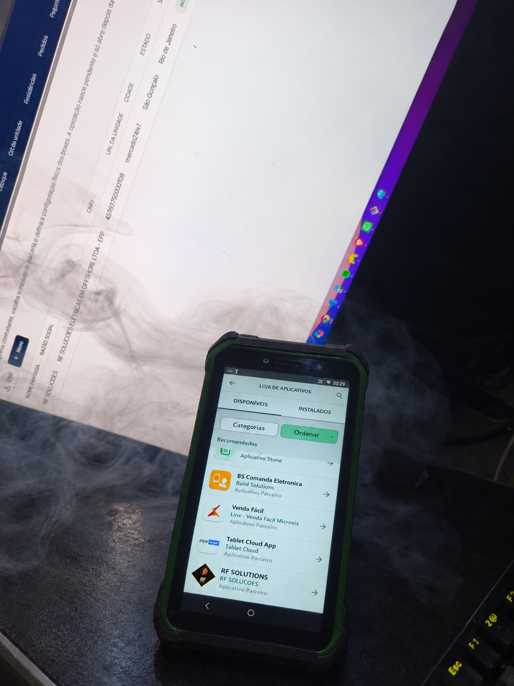</a>

### OFS — Offshore Fleet POB Platform

  <a href="assets/projects/ofs-fleet-dashboard.jpg">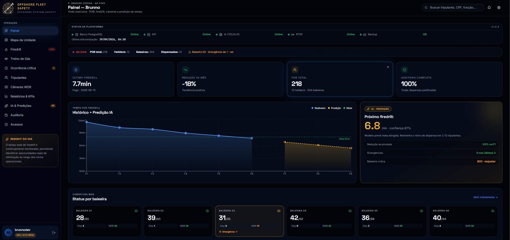</a>

### Arduino / ESP32 Telemetry

<picture>
  <source media="(prefers-reduced-motion: reduce)" srcset="assets/projects/iot-dashboard.jpg" />
  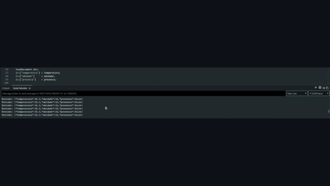
</picture>

View original images

**Device output — ESP32 serial monitor**

  <a href="assets/projects/iot-esp32-serial.jpg">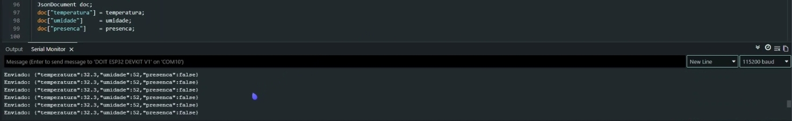</a>

**Python bridge — MQTT messages received**

  <a href="assets/projects/iot-python-mqtt.jpg">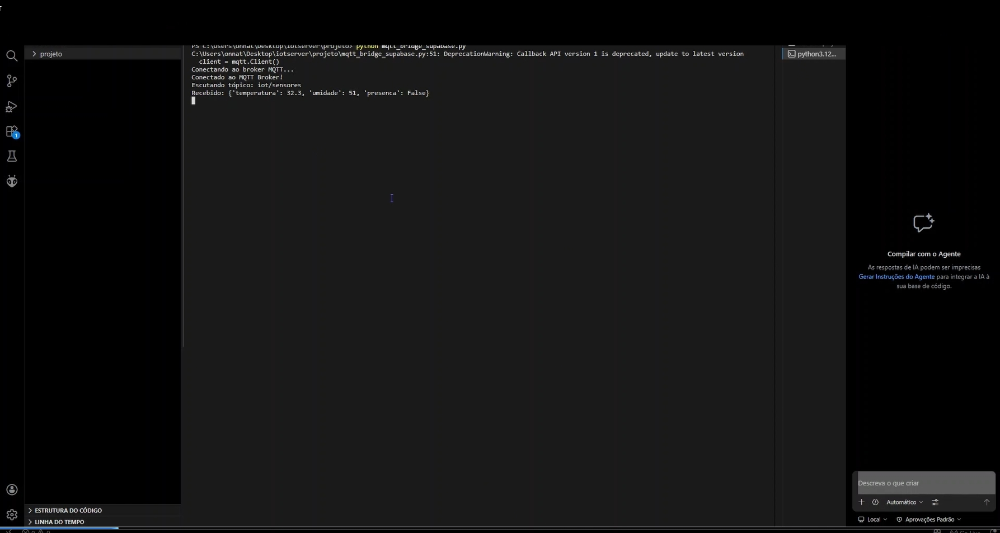</a>

**Database — persisted sensor readings**

  <a href="assets/projects/iot-supabase-readings.jpg">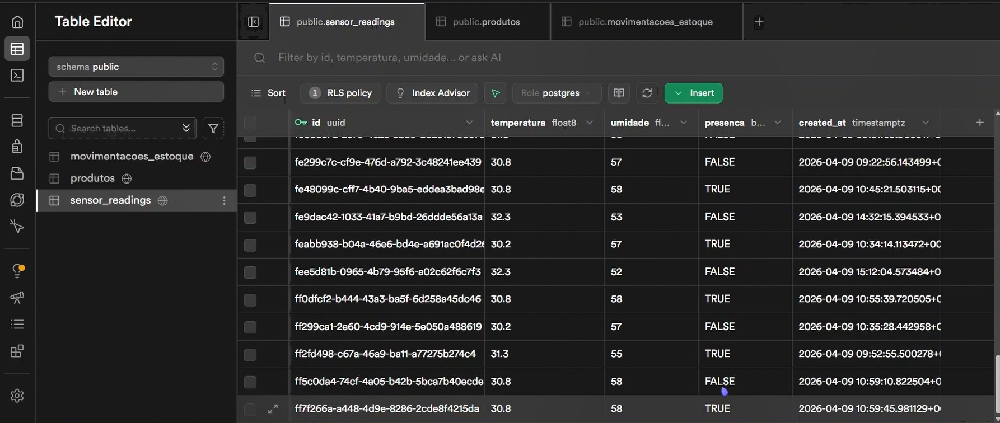</a>

**Dashboard — temperature, humidity and inventory**

  

**Activity log — inventory movements and recent readings**

  <a href="assets/projects/iot-audit-log.jpg">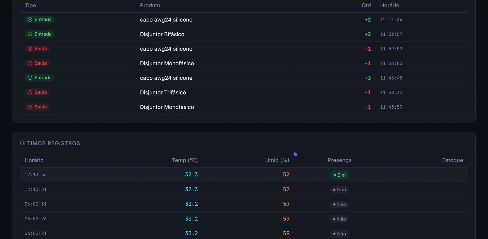</a>

### Workbench & personal projects

<picture>
  <source media="(prefers-reduced-motion: reduce)" srcset="assets/projects/just-for-fun-2.jpeg" />
  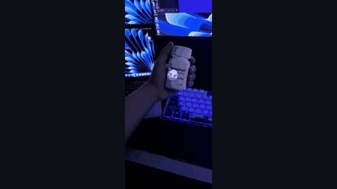
</picture>

View original images

  
  
  

## Project catalog

[All repositories](https://github.com/brunnojob?tab=repositories) · [Laboratory](https://www.brunnodev.store/)

## GitHub activity and languages

[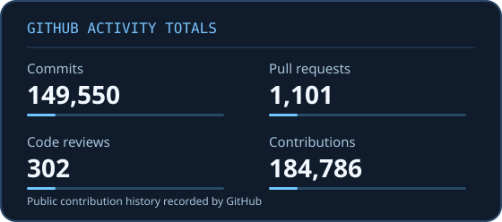](https://github.com/brunnojob#contributions)

<a href="https://github.com/brunnojob#contributions"><picture>
  <source media="(prefers-reduced-motion: reduce)" srcset="assets/profile/profile-streak.png" />
  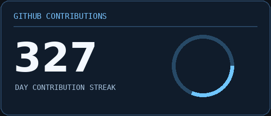
</picture></a>
<a href="#languages-i-use"><picture>
  <source media="(prefers-reduced-motion: reduce)" srcset="assets/profile/profile-languages.png" />
  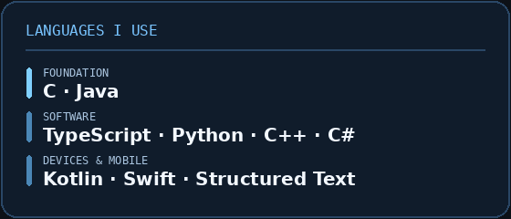
</picture></a>

## Languages I use

<b>C and Java are my foundation · Explore code by language</b>

| Language / target | Source |
|---|---|
| C17 | [Durable archive client](https://github.com/brunnojob/vercel-home-telemetry-api/tree/main/clients/c) |
| C++ | [Concurrent task queue](https://github.com/brunnojob/cpp-safe-task-queue) |
| C# | [Supabase inventory API](https://github.com/brunnojob/csharp-pantry-api) |
| Java | [Balanced ledger](https://github.com/brunnojob/bank-crypto-ledger) |
| Kotlin | [Android inspections](https://github.com/brunnojob/android-offshore-field-console) |
| Swift | [Native inspection store](https://github.com/brunnojob/android-offshore-field-console/tree/main/ios) |
| Ruby | [Git collaboration auditor](https://github.com/brunnojob/pair-extraordinaire-badge) |
| IEC 61131-3 Structured Text / PLC | [Circuit exporter](https://github.com/brunnojob/eletrical-comands-and-teory) |
| SCADA | [Control studio](https://github.com/brunnojob/scada-code-studio) |

## Sponsors

Support funds maintenance, reproducible examples and documentation. Thank you to the people supporting the lab.

  

<!-- sponsors:start -->
<table width="100%">
<tr><td align="center" valign="top"><a href="https://github.com/ineedfoundmyway"> <strong>@ineedfoundmyway</strong></a> PART OF THE STORY Thank you for supporting the lab.</td></tr>
</table>
<!-- sponsors:end -->

[GitHub Sponsors](https://github.com/sponsors/brunnojob) · [Donate via Stripe](https://donate.stripe.com/6oU8wQg9k9Hb8809CrfQI01) · [Buy Me a Coffee](https://buymeacoffee.com/brunnodev)

Public GitHub supporters are synchronized automatically. Private sponsorships stay private.

[Back to top](#top) · [brunnodev.store](https://www.brunnodev.store/) · Original source and documentation: [MIT](LICENSE). Third-party dependencies and media retain their terms.
