
<a href="https://brunnodev.store/">
<picture>
  <source media="(prefers-reduced-motion: reduce)" srcset="assets/profile/intro.png" />
  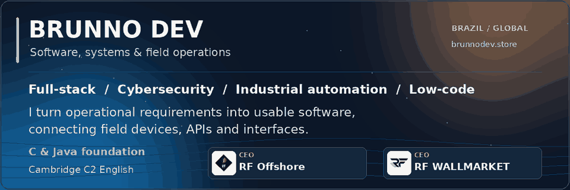
</picture>
</a>

<a href="https://rf-offshore.com/"> <strong>CEO · RF Offshore</strong></a>
&nbsp; · &nbsp;
<a href="https://rfwallmarket.com/"> <strong>CEO · RF WALLMARKET</strong></a>

[Laboratório](https://brunnodev.store/) · [LinkedIn](https://www.linkedin.com/in/brunnojob/) · [Contact](mailto:contato@brunnodev.store) · [Skills](#skills) · [Evidence](#evidence) · [All projects](#all-projects) · [Sponsor](https://github.com/sponsors/brunnojob)

Read the profile summary

**Full-stack development · Cybersecurity · Industrial automation · Low-code**

I turn operational requirements into usable software, connecting field devices, APIs and interfaces. My foundation is **C and Java**; I choose the language for the problem and document the decisions behind it.

**CEO:** [RF Offshore](https://rf-offshore.com/) · [RF WALLMARKET](https://rfwallmarket.com/) &nbsp; | &nbsp; **English:** Cambridge C2

## Check out [brunnodev](https://brunnodev.store/)!

  

### Sponsors

Thank you for supporting my open-source work. Click a photo or name to visit their GitHub profile.

<!-- sponsors:start -->
<table width="100%">
<tr><td align="center" valign="top"><a href="https://github.com/ineedfoundmyway"> <strong>@ineedfoundmyway</strong></a> PART OF THE STORY Thank you for supporting the lab.</td></tr>
</table>
<!-- sponsors:end -->

[Become a sponsor](https://github.com/sponsors/brunnojob) · [Buy Me a Coffee](https://buymeacoffee.com/brunnodev)

## Tools for the developer community

| Project | What it helps you do | Explore |
|---|---|---|
| **[PatchScope](https://github.com/brunnojob/patchscope)** | Turn Git diffs into review checklists in the browser, CLI or GitHub Actions. No dependencies, model keys or code uploads. | [Try it](https://brunnojob.github.io/patchscope/) |
| **[DevStart Lab](https://github.com/brunnojob/devstart-lab)** | Learn programming and GitHub through a roadmap, exercises and project ideas. Free, EN/PT, progress saved in your browser. | [Start learning](https://brunnojob.github.io/devstart-lab/?lang=en) |
| **[SCADA Code Studio](https://github.com/brunnojob/scada-code-studio)** | Explore electrical commands, ladder diagrams and motor states through an interactive interface. | [Open studio](https://brunnojob.github.io/scada-code-studio/) |

## Skills & delivery

| Area | Skills |
|---|---|
| Languages | C / C17, Java, TypeScript, Python, C++, C#, Ruby, Swift, Kotlin, IEC 61131-3 Structured Text |
| Software | Full-stack, system design, API integration, banking APIs, databases, security systems, cybersecurity, testing |
| Field & cloud | PLC, SCADA, signal control, Modbus, PID, Arduino, ESP32, sensor networks, IoT, telemetry, MQTT, WebSockets, AWS, Oracle Cloud IoT, Supabase |
| Product & operations | Mobile UX, device states, field operations, Stone / Sunmi POS, QR payments, checkout, catalog, inventory, cash control, role-based operations |
| Collaboration | Project management, technical writing, documented architecture and technical decisions, Cambridge C2 English |

<b>Inspect implementations by language</b>

| Language / target | Source |
|---|---|
| C17 | [Durable archive client](https://github.com/brunnojob/vercel-home-telemetry-api/tree/main/clients/c) |
| C++ | [Concurrent task queue](https://github.com/brunnojob/cpp-safe-task-queue) |
| C# | [Supabase inventory API](https://github.com/brunnojob/csharp-pantry-api) |
| Java | [Balanced ledger](https://github.com/brunnojob/bank-crypto-ledger) |
| Kotlin | [Android inspections](https://github.com/brunnojob/android-offshore-field-console) |
| Swift | [Native inspection store](https://github.com/brunnojob/android-offshore-field-console/tree/main/ios) |
| Ruby | [Git collaboration auditor](https://github.com/brunnojob/pair-extraordinaire-badge) |
| IEC 61131-3 Structured Text / PLC | [Circuit exporter](https://github.com/brunnojob/eletrical-comands-and-teory) |
| SCADA | [Control studio](https://github.com/brunnojob/scada-code-studio) |

<b>From the field to the interface — architecture & working principles</b>

Sensors and relays feed PLC / SCADA logic, cloud telemetry and operator interfaces; operator decisions feed back into the process.

<picture>
  <source media="(max-width: 600px) and (prefers-reduced-motion: reduce)" srcset="assets/noir/signal-path-mobile.png" />
  <source media="(prefers-reduced-motion: reduce)" srcset="assets/noir/signal-path.png" />
  <source media="(max-width: 600px)" srcset="assets/noir/signal-path-mobile.gif" />
  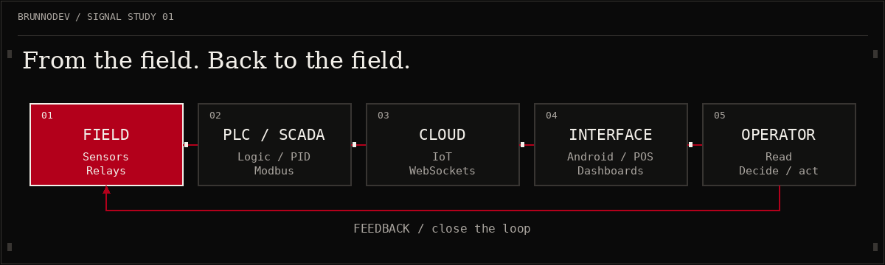
</picture>

Original motion study by Brunno Dev · [Still diagram](assets/noir/signal-path.png) · [Mobile still](assets/noir/signal-path-mobile.png)

| Focus | Work to inspect |
|---|---|
| Electrical commands & process visibility | [Circuit exporter](https://github.com/brunnojob/eletrical-comands-and-teory) · [SCADA studio](https://github.com/brunnojob/scada-code-studio) |
| Connected devices & real-time feedback | [C17 archive client](https://github.com/brunnojob/vercel-home-telemetry-api/tree/main/clients/c) · [Telemetry evidence](#evidence) |
| APIs, security boundaries & data models | [Balanced ledger](https://github.com/brunnojob/bank-crypto-ledger) · [Inventory API](https://github.com/brunnojob/csharp-pantry-api) · [Concurrent queue](https://github.com/brunnojob/cpp-safe-task-queue) |
| Touch-first field interfaces | [Android console](https://github.com/brunnojob/android-offshore-field-console) · [iOS inspection store](https://github.com/brunnojob/android-offshore-field-console/tree/main/ios) |
| Checkout & operator workflows | [Stone POS evidence](#evidence) |

I start with the signal, then the protocol, data model, interface and person using it. Read the signal before writing code; keep operator journeys clear; validate against the real process before shipping.

**Leadership:** RF Offshore — industrial, offshore and field operations. RF WALLMARKET — autonomous retail, infrastructure and operational technology.

## Evidence

[Recorded run](https://github.com/brunnojob/brunnojob/actions/runs/38018340176) · [Execution report](docs/proof/evidence.json) · [Execution index](docs/proof/INDEX.md) · [Project demonstrations](https://brunnojob.github.io/devstart-lab/proofs/?lang=en)

Execution records cover the listed scenarios and source commits. Screenshots below document project interfaces and bench work.

<b>RF Solutions × Stone — POS System</b>

 

  

<b>OFS — Offshore Fleet POB Platform</b>

 

  <a href="assets/projects/ofs-fleet-dashboard.jpg">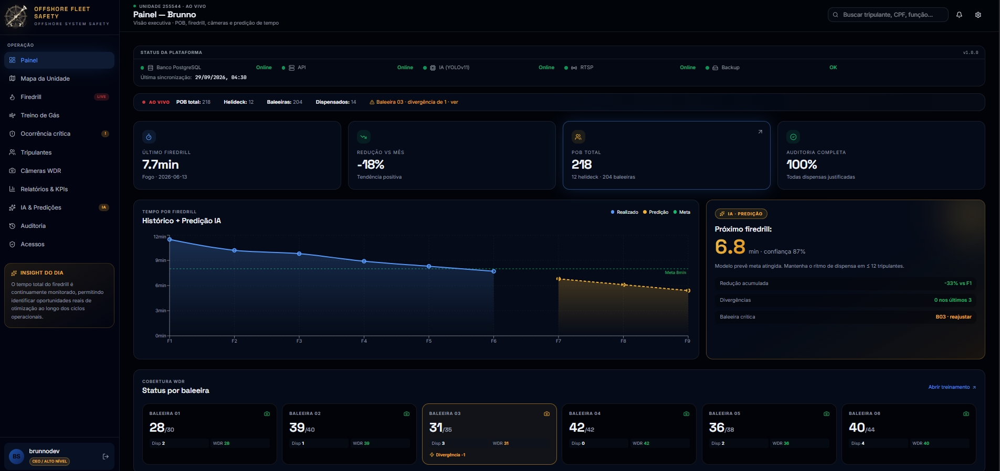</a>

<b>Arduino / ESP32 Telemetry</b>

 

**Device output — ESP32 serial monitor**

  <a href="assets/projects/iot-esp32-serial.jpg">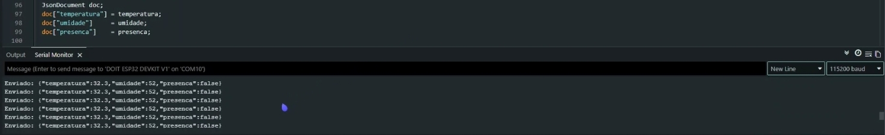</a>

**Python bridge — MQTT messages received**

  <a href="assets/projects/iot-python-mqtt.jpg">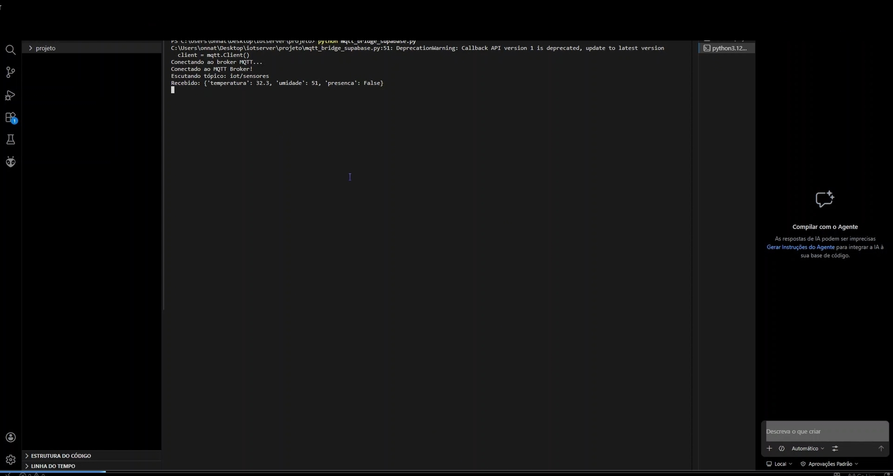</a>

**Database — persisted sensor readings**

  <a href="assets/projects/iot-supabase-readings.jpg">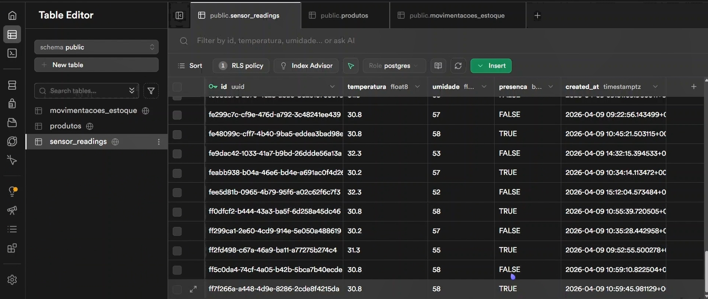</a>

**Dashboard — temperature, humidity and inventory**

  <a href="assets/projects/iot-dashboard.jpg">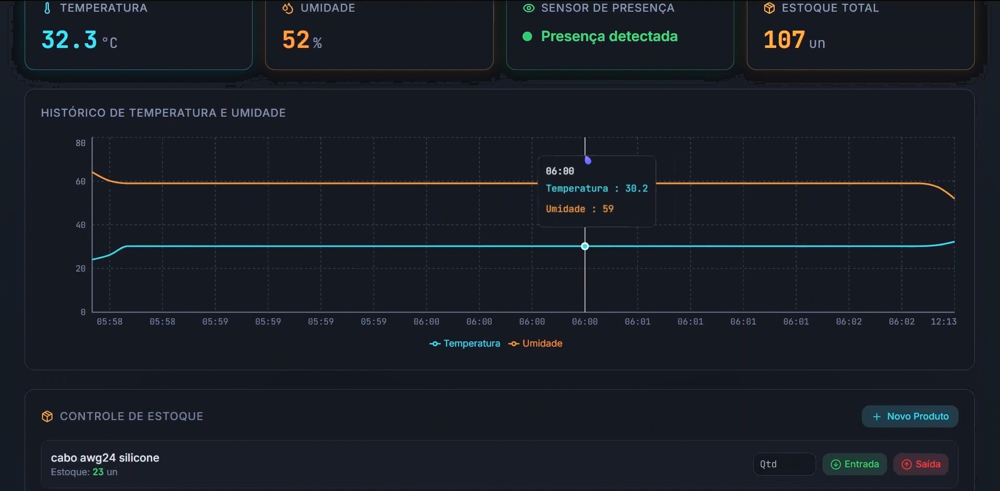</a>

**Activity log — inventory movements and recent readings**

  <a href="assets/projects/iot-audit-log.jpg">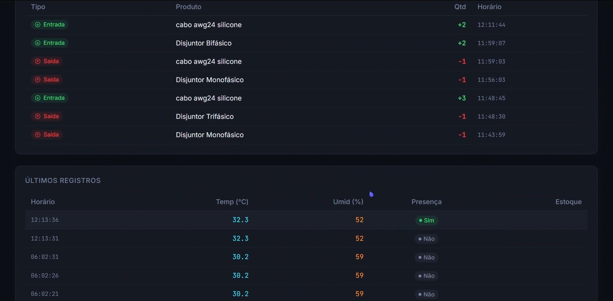</a>

<b>Workbench & personal projects</b>

 

  
  <a href="assets/projects/just-for-fun-2.jpeg">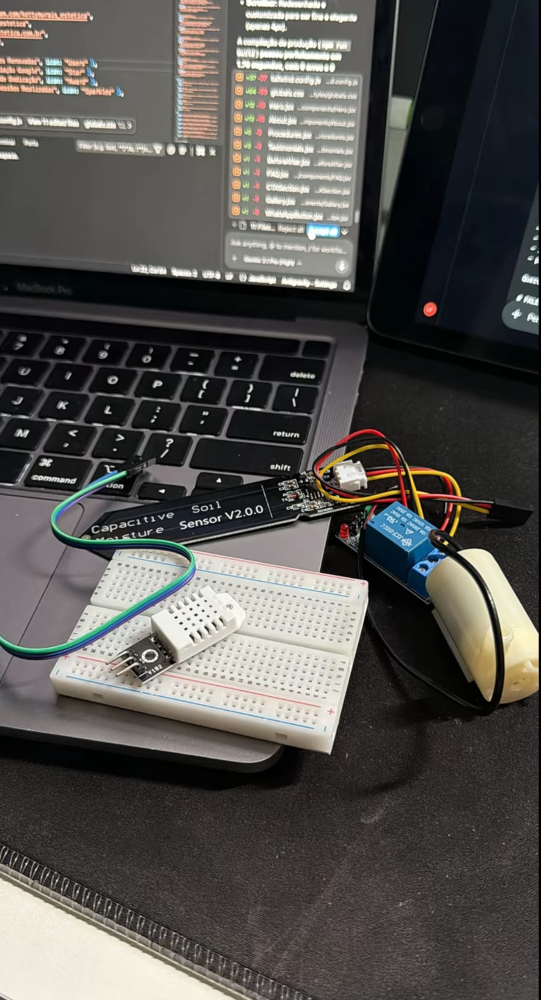</a>
  <a href="assets/projects/just-for-fun-3.jpeg">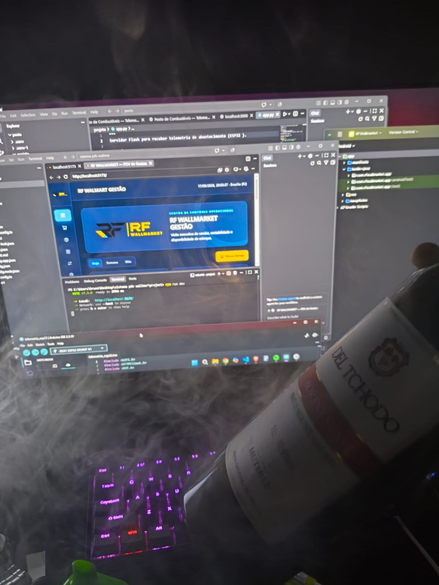</a>

<b>Reproduce the recorded execution</b>

Run `python .proof/record.py` with the prerequisites in the [execution index](docs/proof/INDEX.md). Scenarios run repository code and check exit codes and expected output. CI publishes the `execution-proof` artifact with transcripts, input fingerprints and the source commit. The report identifies the tested version; the badge follows the latest workflow run.

## All projects

[Browse the full project catalog](PROJECTS.md) · [All public repositories](https://github.com/brunnojob?tab=repositories) · [Operations archive](https://vercel-home-telemetry-api.vercel.app/laboratory.html)

<b>Open the complete repository index</b>

[achievement-forge](https://github.com/brunnojob/achievement-forge) · [aegispay](https://github.com/brunnojob/aegispay) · [afterlink](https://github.com/brunnojob/afterlink) · [agent-work-layer](https://github.com/brunnojob/agent-work-layer) · [airflow](https://github.com/brunnojob/airflow) · [android-offshore-field-console](https://github.com/brunnojob/android-offshore-field-console) · [arduino-air-quality-monitor](https://github.com/brunnojob/arduino-air-quality-monitor) · [arduino-cloud-telemetry](https://github.com/brunnojob/arduino-cloud-telemetry) · [arduino-smart-irrigation](https://github.com/brunnojob/arduino-smart-irrigation) · [arduino32-sensor-telemetry](https://github.com/brunnojob/arduino32-sensor-telemetry) · [automacao-orcamento](https://github.com/brunnojob/automacao-orcamento) · [badgeMaster](https://github.com/brunnojob/badgeMaster) · [BadgeMasterfree](https://github.com/brunnojob/BadgeMasterfree) · [badges](https://github.com/brunnojob/badges) · [Badges4-README.md-Profile](https://github.com/brunnojob/Badges4-README.md-Profile) · [bank-crypto-ledger](https://github.com/brunnojob/bank-crypto-ledger) · [brunnojob](https://github.com/brunnojob/brunnojob) · [c-file-integrity-audit](https://github.com/brunnojob/c-file-integrity-audit) · [c-household-budget](https://github.com/brunnojob/c-household-budget) · [c-offshore-can-j1939-inspector](https://github.com/brunnojob/c-offshore-can-j1939-inspector) · [c-offshore-event-journal-validator](https://github.com/brunnojob/c-offshore-event-journal-validator) · [c-offshore-modbus-frame-audit](https://github.com/brunnojob/c-offshore-modbus-frame-audit) · [c-offshore-pump-sequence-replay](https://github.com/brunnojob/c-offshore-pump-sequence-replay) · [c-offshore-redundant-sensor-voter](https://github.com/brunnojob/c-offshore-redundant-sensor-voter) · [c-offshore-vibration-spectrum](https://github.com/brunnojob/c-offshore-vibration-spectrum) · [casino-simulator-brunnodev](https://github.com/brunnojob/casino-simulator-brunnodev) · [cpp-safe-task-queue](https://github.com/brunnojob/cpp-safe-task-queue) · [cpp-water-leak-alarm](https://github.com/brunnojob/cpp-water-leak-alarm) · [csharp-offshore-calibration-regression](https://github.com/brunnojob/csharp-offshore-calibration-regression) · [csharp-offshore-load-shed-optimizer](https://github.com/brunnojob/csharp-offshore-load-shed-optimizer) · [csharp-offshore-permit-conflict-audit](https://github.com/brunnojob/csharp-offshore-permit-conflict-audit) · [csharp-offshore-proof-test-planner](https://github.com/brunnojob/csharp-offshore-proof-test-planner) · [csharp-offshore-trip-log-triage](https://github.com/brunnojob/csharp-offshore-trip-log-triage) · [csharp-offshore-valve-stiction-diagnostic](https://github.com/brunnojob/csharp-offshore-valve-stiction-diagnostic) · [csharp-pantry-api](https://github.com/brunnojob/csharp-pantry-api) · [devpulse-usb](https://github.com/brunnojob/devpulse-usb) · [devstart-lab](https://github.com/brunnojob/devstart-lab) · [eletrical-comands-and-teory](https://github.com/brunnojob/eletrical-comands-and-teory) · [esp32-fuel-simulator](https://github.com/brunnojob/esp32-fuel-simulator) · [faceclock-yolo](https://github.com/brunnojob/faceclock-yolo) · [flowpilot](https://github.com/brunnojob/flowpilot) · [free-contributions](https://github.com/brunnojob/free-contributions) · [fuckup](https://github.com/brunnojob/fuckup) · [FullDots](https://github.com/brunnojob/FullDots) · [github-notification-autofix](https://github.com/brunnojob/github-notification-autofix) · [hardware-firmware-inventory-bridge](https://github.com/brunnojob/hardware-firmware-inventory-bridge) · [industrial-iot-sentinel](https://github.com/brunnojob/industrial-iot-sentinel) · [IoT-RF-Solucoes](https://github.com/brunnojob/IoT-RF-Solucoes) · [java-fuel-efficiency](https://github.com/brunnojob/java-fuel-efficiency) · [java-medication-schedule](https://github.com/brunnojob/java-medication-schedule) · [java-neighborhood-repair-log](https://github.com/brunnojob/java-neighborhood-repair-log) · [java-offshore-alarm-cascade-correlator](https://github.com/brunnojob/java-offshore-alarm-cascade-correlator) · [java-offshore-fault-evidence-ranker](https://github.com/brunnojob/java-offshore-fault-evidence-ranker) · [java-offshore-historian-quality-audit](https://github.com/brunnojob/java-offshore-historian-quality-audit) · [java-offshore-maintenance-critical-path](https://github.com/brunnojob/java-offshore-maintenance-critical-path) · [java-offshore-network-path-diagnostics](https://github.com/brunnojob/java-offshore-network-path-diagnostics) · [java-offshore-spares-reservation-ledger](https://github.com/brunnojob/java-offshore-spares-reservation-ledger) · [mojaloop](https://github.com/brunnojob/mojaloop) · [nodered-industrial-automation](https://github.com/brunnojob/nodered-industrial-automation) · [octometrics-engine](https://github.com/brunnojob/octometrics-engine) · [offshore-barrier](https://github.com/brunnojob/offshore-barrier) · [offshore-scada-simulator](https://github.com/brunnojob/offshore-scada-simulator) · [ofs2x-offshore-operations](https://github.com/brunnojob/ofs2x-offshore-operations) · [ONLINE-transition-Cyber-Security](https://github.com/brunnojob/ONLINE-transition-Cyber-Security) · [painel-admin-aposta](https://github.com/brunnojob/painel-admin-aposta) · [pair-extraordinaire-badge](https://github.com/brunnojob/pair-extraordinaire-badge) · [patchscope](https://github.com/brunnojob/patchscope) · [pid-pressure-control](https://github.com/brunnojob/pid-pressure-control) · [pix-dynamic-payload-generator-dotnet](https://github.com/brunnojob/pix-dynamic-payload-generator-dotnet) · [plantforge-studio](https://github.com/brunnojob/plantforge-studio) · [plc-modbus-safety-controller](https://github.com/brunnojob/plc-modbus-safety-controller) · [portfolio-maker](https://github.com/brunnojob/portfolio-maker) · [python-workflow-automation-lab](https://github.com/brunnojob/python-workflow-automation-lab) · [readme-badges](https://github.com/brunnojob/readme-badges) · [readmenew](https://github.com/brunnojob/readmenew) · [reporelay](https://github.com/brunnojob/reporelay) · [rf-wallmarket-purchase-core](https://github.com/brunnojob/rf-wallmarket-purchase-core) · [saas-clinica-vet](https://github.com/brunnojob/saas-clinica-vet) · [scada-code-studio](https://github.com/brunnojob/scada-code-studio) · [scada-code-studio-review](https://github.com/brunnojob/scada-code-studio-review) · [secure-payment-pos-core](https://github.com/brunnojob/secure-payment-pos-core) · [sloptotal](https://github.com/brunnojob/sloptotal) · [swift-offshore-commissioning-evidence](https://github.com/brunnojob/swift-offshore-commissioning-evidence) · [swift-offshore-compressor-efficiency](https://github.com/brunnojob/swift-offshore-compressor-efficiency) · [swift-offshore-corrosion-trend](https://github.com/brunnojob/swift-offshore-corrosion-trend) · [swift-offshore-downtime-ledger](https://github.com/brunnojob/swift-offshore-downtime-ledger) · [swift-offshore-telemetry-health](https://github.com/brunnojob/swift-offshore-telemetry-health) · [swift-offshore-ups-runtime-estimator](https://github.com/brunnojob/swift-offshore-ups-runtime-estimator) · [trazormodel](https://github.com/brunnojob/trazormodel) · [vercel-home-telemetry-api](https://github.com/brunnojob/vercel-home-telemetry-api) · [yasbd-eu-packs](https://github.com/brunnojob/yasbd-eu-packs) · [yasbd-hooks](https://github.com/brunnojob/yasbd-hooks) · [yasbd-lib](https://github.com/brunnojob/yasbd-lib) · [zero-trust-auth-gateway](https://github.com/brunnojob/zero-trust-auth-gateway)

<b>Official code partner — @ineedfoundmyway</b>

[**@ineedfoundmyway**](https://github.com/ineedfoundmyway) — code, review and build together. Two perspectives, one shared craft.

<a href="https://github.com/ineedfoundmyway"><picture>
<source media="(prefers-reduced-motion: reduce)" srcset="assets/noir/code-partner.png" />
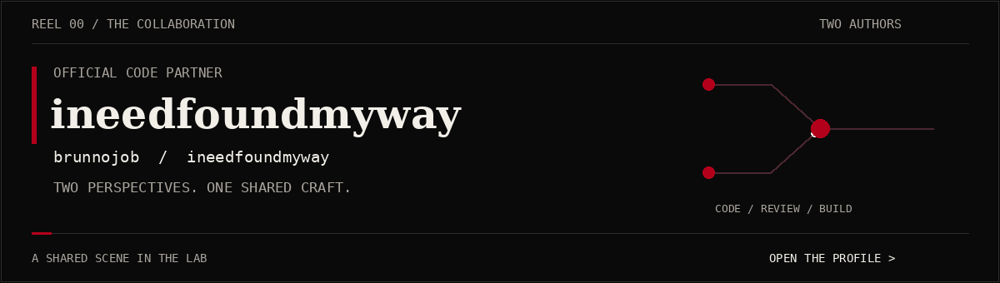
</picture></a>

## Support the work

[GitHub Sponsors](https://github.com/sponsors/brunnojob) · [Donate via Stripe](https://donate.stripe.com/6oU8wQg9k9Hb8809CrfQI01) · [Buy Me a Coffee](https://buymeacoffee.com/brunnodev)

Stripe donations do not grant GitHub’s official Public Sponsor achievement. For GitHub sponsor recognition, contribute through [GitHub Sponsors](https://github.com/sponsors/brunnojob) and choose public visibility. GitHub controls achievement eligibility and display.

Support helps maintain open tools, troubleshoot issues, publish reproducible examples and documentation, and share new experiments and technical decisions.

<b>Public supporters & sponsor collaboration</b>

Verified sponsors can discuss code reviews, troubleshooting, project guidance and collaboration. Private access instructions are in the GitHub Sponsors welcome message; selected tier terms apply. Buy Me a Coffee uses separate verification. Keep payment details and private project information out of public issues.

Public GitHub supporters are synchronized automatically; private sponsorships stay private.

Build systems. Read signals. Ship operations. · [Back to top](#top) · Original source and documentation: [MIT](LICENSE). Third-party dependencies and media retain their terms. Maintained by [Brunno Dev](https://brunnodev.store/).
