<div align="center">

<a href="https://brunnodev.store/">
  
</a>

<br/>

[](https://brunnodev.store/)
[](https://github.com/brunnojob/brunnojob/blob/main/PROJECTS.md)
[](https://github.com/brunnojob?tab=repositories)

<sub>choose your scene</sub>

[](#the-pact)
[](#signal-path)
[](#arsenal)
[](#two-faces)
[](#evidence)
[](#cast)
[](#proof)

</div>


<a id="the-pact"></a>

<iframe src="https://github.com/sponsors/brunnojob/button" title="Sponsor brunnojob" height="32" width="114" style="border: 0; border-radius: 6px;"></iframe>

## I. The Pact

```text
EXT. AN OPEN FIELD — DUSK

A beast with horns and a figure in white dance on the horizon.
Neither leads. Neither falls.

                                   NARRATOR (V.O.)
               Every system is that dance. On one side, the beast:
               voltage, noise, relays, legacy protocols, hardware
               that does not forgive. On the other, the grace: an
               operator's thumb on a screen, a checkout that closes,
               a dashboard that tells the truth at 3 a.m.

                                                           CUT TO:
```

I build the choreography between the two.

**Architecture, journeys and technical decisions focused on operational results.**
SCADA, PLC, IoT, automation and signal reading for real processes.
I connect engineering thinking, digital product and operational context to turn messy requirements into usable systems.

> [!CAUTION]
> This is not a portfolio. It is not a services page. **It is a working laboratory.**

<details>
<summary><b>🎬 Director's notes</b> <sub>(open)</sub></summary>
<br>

| # | Rule on set |
|---|---|
| 01 | Read the signal before writing the code. |
| 02 | If the operator needs a manual, the interface failed. |
| 03 | Nothing ships until it has run against the real process. |

</details>


<a id="signal-path"></a>

## II. Signal Path

<sub>From a wire in the field to a decision on a screen. Every reel below is one stretch of this path.</sub>

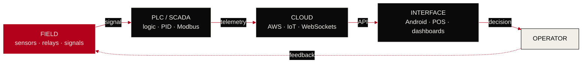

<details>
<summary><b>REEL 01 — Automation & industrial logic</b> · <i>the beast wakes up</i></summary>
<br>

```text
INT. CONTROL ROOM — NIGHT
A relay clicks. A PLC answers. The process becomes visible.
```

Electrical commands, PLC/SCADA thinking and process visibility.

**PLC / SCADA / SIGNAL CONTROL / MODBUS / PID**

▸ On screen: [Circuit exporter](https://github.com/brunnojob/eletrical-comands-and-teory) · [SCADA control studio](https://github.com/brunnojob/scada-code-studio)

</details>

<details>
<summary><b>REEL 02 — IoT & telemetry</b> · <i>the field starts talking</i></summary>
<br>

```text
EXT. ANYWHERE — CONTINUOUS
A sensor whispers. The cloud listens. A chart moves in real time.
```

Sensors, connected devices, cloud signals and real-time product feedback.

**ARDUINO / CLOUD IoT / TELEMETRY / WEBSOCKETS / SENSOR NETWORKS**

▸ On screen: [Durable archive client (C17)](https://github.com/brunnojob/vercel-home-telemetry-api/tree/main/clients/c) · [Arduino telemetry evidence](#evidence)

</details>

<details>
<summary><b>REEL 03 — System architecture</b> · <i>the rules of the house</i></summary>
<br>

```text
INT. THE VAULT — DAY
Every request has a door. Every door has a lock.
```

APIs, integrations, security boundaries and sustainable technical decisions.

**BANK APIs / SECURITY SYSTEMS / DATABASES / AWS / SYSTEM DESIGN**

▸ On screen: [Balanced ledger](https://github.com/brunnojob/bank-crypto-ledger) · [Supabase inventory API](https://github.com/brunnojob/csharp-pantry-api) · [Concurrent task queue](https://github.com/brunnojob/cpp-safe-task-queue)

</details>

<details>
<summary><b>REEL 04 — Android field interfaces</b> · <i>gloves on, screen on</i></summary>
<br>

```text
EXT. OFFSHORE DECK — WIND
An operator taps once. The inspection is saved. No one waits.
```

Touch-first surfaces for mobile operators and hardware-aware workflows.

**KOTLIN / MOBILE UX / DEVICE STATES / FIELD OPERATIONS**

▸ On screen: [Android offshore field console](https://github.com/brunnojob/android-offshore-field-console) · [Native iOS inspection store](https://github.com/brunnojob/android-offshore-field-console/tree/main/ios)

</details>

<details>
<summary><b>REEL 05 — POS & payment systems</b> · <i>the money scene</i></summary>
<br>

```text
INT. STORE COUNTER — RUSH HOUR
Card in. QR on screen. Stock updated. Cash drawer reconciled.
```

Checkout, catalog, inventory, cash control and role-based operations.

**STONE / SUNMI / POS / QR / OPERATOR UX**

▸ On screen: [RF Solutions × Stone POS evidence](#evidence)

</details>


<a id="arsenal"></a>

## III. Arsenal

<div align="center">

<sub>LANGUAGES I SPEAK TO MACHINES</sub><br/>


<sub>THE CRAFT</sub><br/>


<sub>THE BEAST — FIELD & CLOUD</sub><br/>


<sub>THE GRACE — BEYOND CODE</sub><br/>


</div>


<a id="two-faces"></a>

## IV. Two Faces

<p align="center">
  
</p>

| Company | Role | Operating focus |
|---|---|---|
| [RF Offshore](https://rf-offshore.com/) | **CEO** | Industrial, offshore and field operations |
| [RF WALLMARKET](https://rfwallmarket.com/) | **CEO** | Autonomous retail, infrastructure and operational technology |


<a id="evidence"></a>

## V. Evidence Locker

<sub>Project screenshots and bench photos. Open a case to view the original images.</sub>

<details>
<summary><b>CASE #01 — RF Solutions × Stone — POS System</b></summary>
<br>
<p align="center">
  <a href="assets/projects/stone-pos-system.png">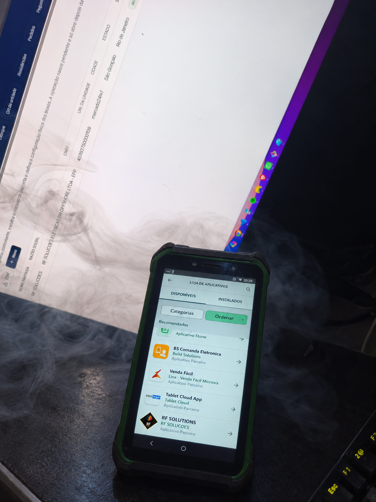</a>
</p>
</details>

<details>
<summary><b>CASE #02 — OFS — Offshore Fleet POB Platform</b></summary>
<br>
<p align="center">
  <a href="assets/projects/ofs-fleet-dashboard.jpg">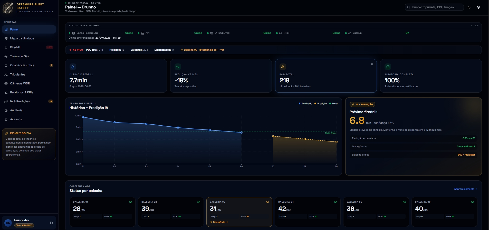</a>
</p>
</details>

<details>
<summary><b>CASE #03 — Arduino / ESP32 Telemetry</b></summary>
<br>

**Device output — ESP32 serial monitor**

<p align="center">
  <a href="assets/projects/iot-esp32-serial.jpg">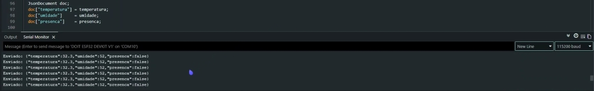</a>
</p>

**Python bridge — MQTT messages received**

<p align="center">
  <a href="assets/projects/iot-python-mqtt.jpg">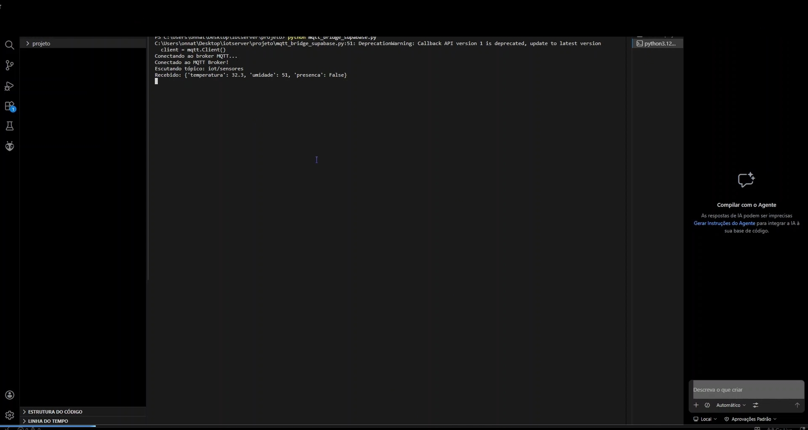</a>
</p>

**Database — persisted sensor readings**

<p align="center">
  <a href="assets/projects/iot-supabase-readings.jpg">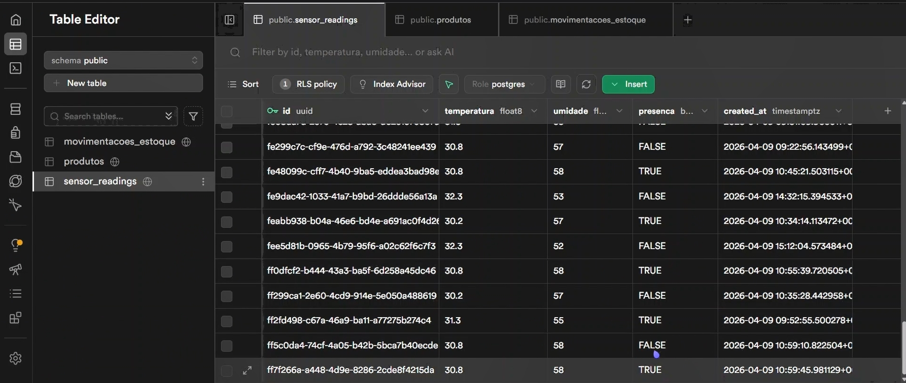</a>
</p>

**Dashboard — temperature, humidity and inventory**

<p align="center">
  <a href="assets/projects/iot-dashboard.jpg">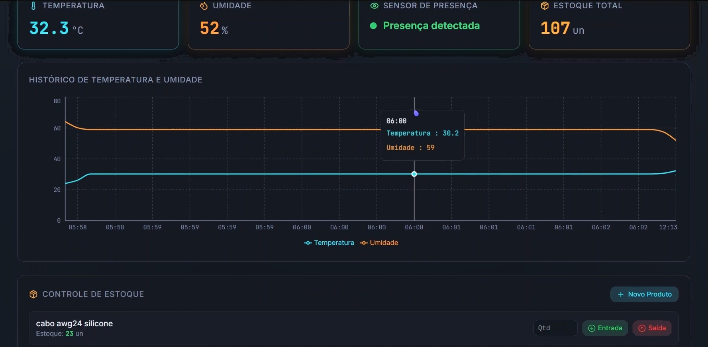</a>
</p>

**Activity log — inventory movements and recent readings**

<p align="center">
  <a href="assets/projects/iot-audit-log.jpg">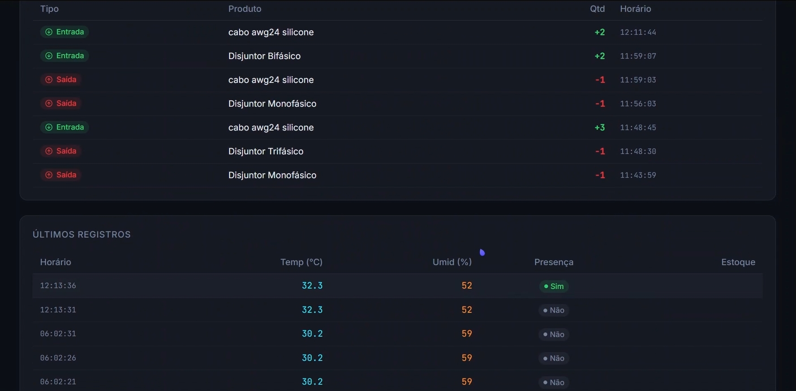</a>
</p>
</details>

<details>
<summary><b>CASE #04 — Just for Fun</b> · <i>off the record</i></summary>
<br>
<p align="center">
  <a href="assets/projects/just-for-fun-1.jpeg">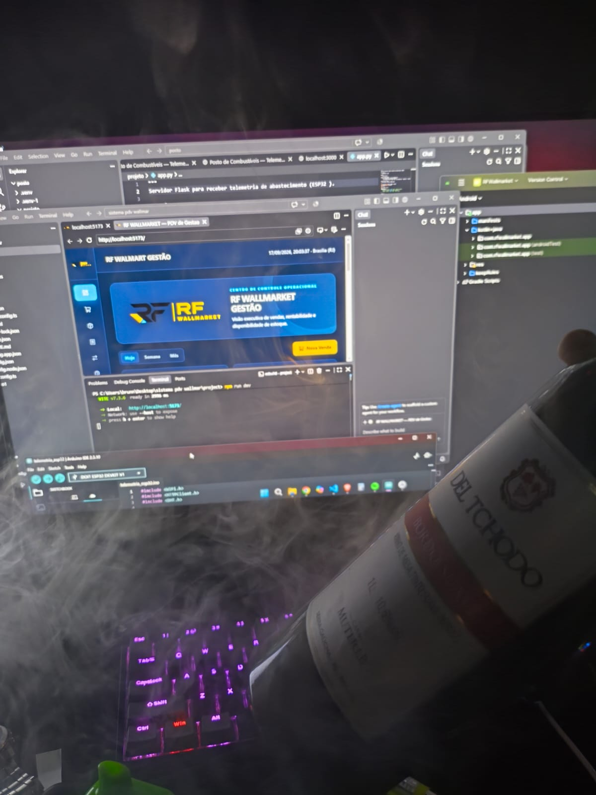</a>
  <a href="assets/projects/just-for-fun-2.jpeg">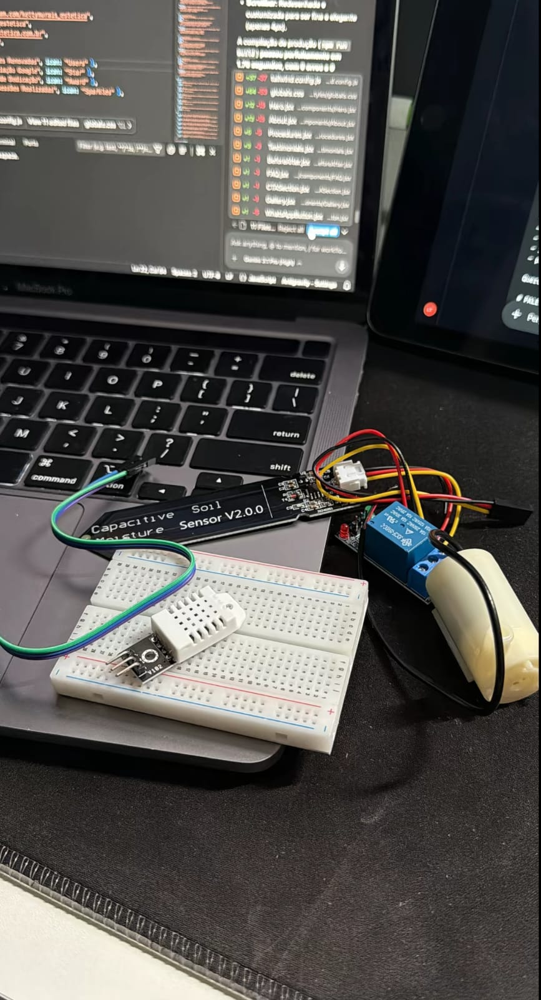</a>
  <a href="assets/projects/just-for-fun-3.jpeg"></a>
</p>
</details>

<a id="projects"></a>

### Projects

<p align="center">
  <a href="https://github.com/brunnojob/brunnojob/blob/main/PROJECTS.md"></a>
  <a href="https://github.com/brunnojob?tab=repositories"></a>
</p>


<a id="cast"></a>

## VI. Cast & Credits

<p align="center">
  
</p>

<details open>
<summary><b>Cast sheet — native implementations</b> <sub>(click a role to watch the scene)</sub></summary>
<br>

| Actor · language / target | Role · working source |
|---|---|
| C17 | [Durable archive client](https://github.com/brunnojob/vercel-home-telemetry-api/tree/main/clients/c) |
| C++ | [Concurrent task queue](https://github.com/brunnojob/cpp-safe-task-queue) |
| C# | [Supabase inventory API](https://github.com/brunnojob/csharp-pantry-api) |
| Java | [Balanced ledger](https://github.com/brunnojob/bank-crypto-ledger) |
| Kotlin | [Android inspections](https://github.com/brunnojob/android-offshore-field-console) |
| Swift | [Native inspection store](https://github.com/brunnojob/android-offshore-field-console/tree/main/ios) |
| Ruby | [Git collaboration auditor](https://github.com/brunnojob/pair-extraordinaire-badge) |
| IEC 61131-3 Structured Text / PLC | [Circuit exporter](https://github.com/brunnojob/eletrical-comands-and-teory) |
| SCADA | [Control studio](https://github.com/brunnojob/scada-code-studio) |

</details>


<a id="proof"></a>

## VII. Proof of Life

<sub>Execution proof. The film is not edited: every scene runs.</sub>

[](https://github.com/brunnojob/brunnojob/actions/workflows/proof.yml)

[Verified run](https://github.com/brunnojob/brunnojob/actions/runs/38018340176) · [Execution report](https://github.com/brunnojob/brunnojob/blob/main/docs/proof/evidence.json) · [Verified execution index](https://github.com/brunnojob/brunnojob/blob/main/docs/proof/INDEX.md)

<details>
<summary><b>How to reproduce the take</b></summary>
<br>

Run `python .proof/record.py` with the prerequisites listed in the execution index. The scenarios execute repository code and verify exit codes and expected output. CI publishes `execution-proof` with the transcript, input fingerprints and source commit. The downloadable report identifies the exact tested version; the workflow badge tracks the latest run.

</details>

<br/>

<div align="center">

<a href="https://brunnodev.store/">
  
</a>

**BUILD SYSTEMS. READ SIGNALS. SHIP OPERATIONS.**

[](https://brunnodev.store/)
[](https://github.com/brunnojob/brunnojob/blob/main/PROJECTS.md)

<sub>Original source and documentation are MIT licensed; see [LICENSE](LICENSE). Third-party dependencies and media retain their respective terms. Maintained by [Brunno Dev](https://brunnodev.store).</sub>

# Displaying a sponsor button in your repository

You can add a sponsor button in your repository to increase the visibility of funding options for your open source project.

## About FUNDING files

You can configure your sponsor button by editing a `FUNDING.yml` file in your repository's `.github` folder, on the default branch. You can configure the button to include sponsored developers in GitHub Sponsors, external funding platforms, or a custom funding URL. For more information about GitHub Sponsors, see [About GitHub Sponsors](/en/sponsors/getting-started-with-github-sponsors/about-github-sponsors).

You can add one username, package name, or project name per external funding platform and up to four custom URLs. You can add one organization and up to four sponsored developers in GitHub Sponsors. Add each platform on a new line, using the following syntax.

| Platform                                                                                      | Syntax                                                                   |
| --------------------------------------------------------------------------------------------- | ------------------------------------------------------------------------ |
| [LFX Mentorship (formerly CommunityBridge)](https://lfx.linuxfoundation.org/tools/mentorship) | `community_bridge: PROJECT-NAME`                                         |
| [GitHub Sponsors](https://github.com/sponsors)                                                | `github: USERNAME` or `github: [USERNAME, USERNAME, USERNAME, USERNAME]` |
| [IssueHunt](https://issuehunt.io/)                                                            | `issuehunt: USERNAME`                                                    |
| [Ko-fi](https://ko-fi.com/)                                                                   | `ko_fi: USERNAME`                                                        |
| [Liberapay](https://en.liberapay.com/)                                                        | `liberapay: USERNAME`                                                    |
| [Open Collective](https://opencollective.com/)                                                | `open_collective: USERNAME`                                              |
| [Patreon](https://www.patreon.com/)                                                           | `patreon: USERNAME`                                                      |
| [Tidelift](https://tidelift.com/)                                                             | `tidelift: PLATFORM-NAME/PACKAGE-NAME`                                   |
| [Polar](https://www.polar.sh/)                                                                | `polar: USERNAME`                                                        |
| [Buy Me a Coffee](https://www.buymeacoffee.com/)                                              | `buy_me_a_coffee: USERNAME`                                              |
| [thanks.dev](https://thanks.dev/)                                                             | `thanks_dev: u/gh/USERNAME`                                              |
| Custom URL                                                                                    | `custom: LINK1` or `custom: [LINK1, LINK2, LINK3, LINK4]`                |

For Tidelift, use the `platform-name/package-name` syntax with the following platform names.

| Language   | Platform name |
| ---------- | ------------- |
| JavaScript | `npm`         |
| Python     | `pypi`        |
| Ruby       | `rubygems`    |
| Java       | `maven`       |
| PHP        | `packagist`   |
| C#         | `nuget`       |

Here's an example `FUNDING.yml` file:

```yaml
github: [octocat, surftocat]
patreon: octocat
tidelift: npm/octo-package
custom: ["https://www.paypal.me/octocat", octocat.com]
```

> [!NOTE]
> If a custom URL in an array includes `:`, you must wrap the URL in quotes. For example, `"https://www.paypal.me/octocat"`.

You can create a default sponsor button for your organization or personal account. For more information, see [Creating a default community health file](/en/communities/setting-up-your-project-for-healthy-contributions/creating-a-default-community-health-file).

> [!NOTE]
> Funding links provide a way for open source projects to receive direct financial support from their community. We don’t support the use of funding links for other purposes, such as for advertising, or supporting political, community, or charity groups. If you have questions about whether your intended use is supported, please visit [GitHub Support](https://support.github.com).

## Displaying a sponsor button in your repository

Anyone with admin permissions can enable a sponsor button in a repository.

1. On GitHub, navigate to the main page of the repository.

2. Under your repository name, click **<svg version="1.1" width="16" height="16" viewBox="0 0 16 16" class="octicon octicon-gear" aria-label="gear" role="img"><path d="M8 0a8.2 8.2 0 0 1 .701.031C9.444.095 9.99.645 10.16 1.29l.288 1.107c.018.066.079.158.212.224.231.114.454.243.668.386.123.082.233.09.299.071l1.103-.303c.644-.176 1.392.021 1.82.63.27.385.506.792.704 1.218.315.675.111 1.422-.364 1.891l-.814.806c-.049.048-.098.147-.088.294.016.257.016.515 0 .772-.01.147.038.246.088.294l.814.806c.475.469.679 1.216.364 1.891a7.977 7.977 0 0 1-.704 1.217c-.428.61-1.176.807-1.82.63l-1.102-.302c-.067-.019-.177-.011-.3.071a5.909 5.909 0 0 1-.668.386c-.133.066-.194.158-.211.224l-.29 1.106c-.168.646-.715 1.196-1.458 1.26a8.006 8.006 0 0 1-1.402 0c-.743-.064-1.289-.614-1.458-1.26l-.289-1.106c-.018-.066-.079-.158-.212-.224a5.738 5.738 0 0 1-.668-.386c-.123-.082-.233-.09-.299-.071l-1.103.303c-.644.176-1.392-.021-1.82-.63a8.12 8.12 0 0 1-.704-1.218c-.315-.675-.111-1.422.363-1.891l.815-.806c.05-.048.098-.147.088-.294a6.214 6.214 0 0 1 0-.772c.01-.147-.038-.246-.088-.294l-.815-.806C.635 6.045.431 5.298.746 4.623a7.92 7.92 0 0 1 .704-1.217c.428-.61 1.176-.807 1.82-.63l1.102.302c.067.019.177.011.3-.071.214-.143.437-.272.668-.386.133-.066.194-.158.211-.224l.29-1.106C6.009.645 6.556.095 7.299.03 7.53.01 7.764 0 8 0Zm-.571 1.525c-.036.003-.108.036-.137.146l-.289 1.105c-.147.561-.549.967-.998 1.189-.173.086-.34.183-.5.29-.417.278-.97.423-1.529.27l-1.103-.303c-.109-.03-.175.016-.195.045-.22.312-.412.644-.573.99-.014.031-.021.11.059.19l.815.806c.411.406.562.957.53 1.456a4.709 4.709 0 0 0 0 .582c.032.499-.119 1.05-.53 1.456l-.815.806c-.081.08-.073.159-.059.19.162.346.353.677.573.989.02.03.085.076.195.046l1.102-.303c.56-.153 1.113-.008 1.53.27.161.107.328.204.501.29.447.222.85.629.997 1.189l.289 1.105c.029.109.101.143.137.146a6.6 6.6 0 0 0 1.142 0c.036-.003.108-.036.137-.146l.289-1.105c.147-.561.549-.967.998-1.189.173-.086.34-.183.5-.29.417-.278.97-.423 1.529-.27l1.103.303c.109.029.175-.016.195-.045.22-.313.411-.644.573-.99.014-.031.021-.11-.059-.19l-.815-.806c-.411-.406-.562-.957-.53-1.456a4.709 4.709 0 0 0 0-.582c-.032-.499.119-1.05.53-1.456l.815-.806c.081-.08.073-.159.059-.19a6.464 6.464 0 0 0-.573-.989c-.02-.03-.085-.076-.195-.046l-1.102.303c-.56.153-1.113.008-1.53-.27a4.44 4.44 0 0 0-.501-.29c-.447-.222-.85-.629-.997-1.189l-.289-1.105c-.029-.11-.101-.143-.137-.146a6.6 6.6 0 0 0-1.142 0ZM11 8a3 3 0 1 1-6 0 3 3 0 0 1 6 0ZM9.5 8a1.5 1.5 0 1 0-3.001.001A1.5 1.5 0 0 0 9.5 8Z"></path></svg> Settings**. If you cannot see the "Settings" tab, select the **<svg version="1.1" width="16" height="16" viewBox="0 0 16 16" class="octicon octicon-kebab-horizontal" aria-label="More" role="img"><path d="M8 9a1.5 1.5 0 1 0 0-3 1.5 1.5 0 0 0 0 3ZM1.5 9a1.5 1.5 0 1 0 0-3 1.5 1.5 0 0 0 0 3Zm13 0a1.5 1.5 0 1 0 0-3 1.5 1.5 0 0 0 0 3Z"></path></svg>** dropdown menu, then click **Settings**.

   

3. On the "General" settings page, in the "Features" section, select **Sponsorships**.

4. In the "Sponsorships" box, click **Set up sponsor button** or **Override funding links**.

5. In the file editor, follow the instructions in the `FUNDING.yml` file to add links to your funding locations.

6. Click **Commit changes...**

7. In the "Commit message" field, type a short, meaningful commit message that describes the change you made to the file. You can attribute the commit to more than one author in the commit message. For more information, see [Creating a commit with multiple authors or on behalf of an organization](/en/pull-requests/how-tos/commit-changes/creating-a-commit-with-multiple-authors).

8. Below the commit message fields, decide whether to add your commit to the current branch or to a new branch. If your current branch is the default branch, you should choose to create a new branch for your commit and then create a pull request. For more information, see [Creating a pull request](/en/pull-requests/how-tos/create-pull-requests/creating-a-pull-request).

   

9. Click **Commit changes** or **Propose changes**.

## Further reading

# Displaying a sponsor button in your repository

You can add a sponsor button in your repository to increase the visibility of funding options for your open source project.

## About FUNDING files

You can configure your sponsor button by editing a `FUNDING.yml` file in your repository's `.github` folder, on the default branch. You can configure the button to include sponsored developers in GitHub Sponsors, external funding platforms, or a custom funding URL. For more information about GitHub Sponsors, see [About GitHub Sponsors](/en/sponsors/getting-started-with-github-sponsors/about-github-sponsors).

You can add one username, package name, or project name per external funding platform and up to four custom URLs. You can add one organization and up to four sponsored developers in GitHub Sponsors. Add each platform on a new line, using the following syntax.

| Platform                                                                                      | Syntax                                                                   |
| --------------------------------------------------------------------------------------------- | ------------------------------------------------------------------------ |
| [LFX Mentorship (formerly CommunityBridge)](https://lfx.linuxfoundation.org/tools/mentorship) | `community_bridge: PROJECT-NAME`                                         |
| [GitHub Sponsors](https://github.com/sponsors)                                                | `github: USERNAME` or `github: [USERNAME, USERNAME, USERNAME, USERNAME]` |
| [IssueHunt](https://issuehunt.io/)                                                            | `issuehunt: USERNAME`                                                    |
| [Ko-fi](https://ko-fi.com/)                                                                   | `ko_fi: USERNAME`                                                        |
| [Liberapay](https://en.liberapay.com/)                                                        | `liberapay: USERNAME`                                                    |
| [Open Collective](https://opencollective.com/)                                                | `open_collective: USERNAME`                                              |
| [Patreon](https://www.patreon.com/)                                                           | `patreon: USERNAME`                                                      |
| [Tidelift](https://tidelift.com/)                                                             | `tidelift: PLATFORM-NAME/PACKAGE-NAME`                                   |
| [Polar](https://www.polar.sh/)                                                                | `polar: USERNAME`                                                        |
| [Buy Me a Coffee](https://www.buymeacoffee.com/)                                              | `buy_me_a_coffee: USERNAME`                                              |
| [thanks.dev](https://thanks.dev/)                                                             | `thanks_dev: u/gh/USERNAME`                                              |
| Custom URL                                                                                    | `custom: LINK1` or `custom: [LINK1, LINK2, LINK3, LINK4]`                |

For Tidelift, use the `platform-name/package-name` syntax with the following platform names.

| Language   | Platform name |
| ---------- | ------------- |
| JavaScript | `npm`         |
| Python     | `pypi`        |
| Ruby       | `rubygems`    |
| Java       | `maven`       |
| PHP        | `packagist`   |
| C#         | `nuget`       |

Here's an example `FUNDING.yml` file:

```yaml
github: [octocat, surftocat]
patreon: octocat
tidelift: npm/octo-package
custom: ["https://www.paypal.me/octocat", octocat.com]
```

> [!NOTE]
> If a custom URL in an array includes `:`, you must wrap the URL in quotes. For example, `"https://www.paypal.me/octocat"`.

You can create a default sponsor button for your organization or personal account. For more information, see [Creating a default community health file](/en/communities/setting-up-your-project-for-healthy-contributions/creating-a-default-community-health-file).

> [!NOTE]
> Funding links provide a way for open source projects to receive direct financial support from their community. We don’t support the use of funding links for other purposes, such as for advertising, or supporting political, community, or charity groups. If you have questions about whether your intended use is supported, please visit [GitHub Support](https://support.github.com).

## Displaying a sponsor button in your repository

Anyone with admin permissions can enable a sponsor button in a repository.

1. On GitHub, navigate to the main page of the repository.

2. Under your repository name, click **<svg version="1.1" width="16" height="16" viewBox="0 0 16 16" class="octicon octicon-gear" aria-label="gear" role="img"><path d="M8 0a8.2 8.2 0 0 1 .701.031C9.444.095 9.99.645 10.16 1.29l.288 1.107c.018.066.079.158.212.224.231.114.454.243.668.386.123.082.233.09.299.071l1.103-.303c.644-.176 1.392.021 1.82.63.27.385.506.792.704 1.218.315.675.111 1.422-.364 1.891l-.814.806c-.049.048-.098.147-.088.294.016.257.016.515 0 .772-.01.147.038.246.088.294l.814.806c.475.469.679 1.216.364 1.891a7.977 7.977 0 0 1-.704 1.217c-.428.61-1.176.807-1.82.63l-1.102-.302c-.067-.019-.177-.011-.3.071a5.909 5.909 0 0 1-.668.386c-.133.066-.194.158-.211.224l-.29 1.106c-.168.646-.715 1.196-1.458 1.26a8.006 8.006 0 0 1-1.402 0c-.743-.064-1.289-.614-1.458-1.26l-.289-1.106c-.018-.066-.079-.158-.212-.224a5.738 5.738 0 0 1-.668-.386c-.123-.082-.233-.09-.299-.071l-1.103.303c-.644.176-1.392-.021-1.82-.63a8.12 8.12 0 0 1-.704-1.218c-.315-.675-.111-1.422.363-1.891l.815-.806c.05-.048.098-.147.088-.294a6.214 6.214 0 0 1 0-.772c.01-.147-.038-.246-.088-.294l-.815-.806C.635 6.045.431 5.298.746 4.623a7.92 7.92 0 0 1 .704-1.217c.428-.61 1.176-.807 1.82-.63l1.102.302c.067.019.177.011.3-.071.214-.143.437-.272.668-.386.133-.066.194-.158.211-.224l.29-1.106C6.009.645 6.556.095 7.299.03 7.53.01 7.764 0 8 0Zm-.571 1.525c-.036.003-.108.036-.137.146l-.289 1.105c-.147.561-.549.967-.998 1.189-.173.086-.34.183-.5.29-.417.278-.97.423-1.529.27l-1.103-.303c-.109-.03-.175.016-.195.045-.22.312-.412.644-.573.99-.014.031-.021.11.059.19l.815.806c.411.406.562.957.53 1.456a4.709 4.709 0 0 0 0 .582c.032.499-.119 1.05-.53 1.456l-.815.806c-.081.08-.073.159-.059.19.162.346.353.677.573.989.02.03.085.076.195.046l1.102-.303c.56-.153 1.113-.008 1.53.27.161.107.328.204.501.29.447.222.85.629.997 1.189l.289 1.105c.029.109.101.143.137.146a6.6 6.6 0 0 0 1.142 0c.036-.003.108-.036.137-.146l.289-1.105c.147-.561.549-.967.998-1.189.173-.086.34-.183.5-.29.417-.278.97-.423 1.529-.27l1.103.303c.109.029.175-.016.195-.045.22-.313.411-.644.573-.99.014-.031.021-.11-.059-.19l-.815-.806c-.411-.406-.562-.957-.53-1.456a4.709 4.709 0 0 0 0-.582c-.032-.499.119-1.05.53-1.456l.815-.806c.081-.08.073-.159.059-.19a6.464 6.464 0 0 0-.573-.989c-.02-.03-.085-.076-.195-.046l-1.102.303c-.56.153-1.113.008-1.53-.27a4.44 4.44 0 0 0-.501-.29c-.447-.222-.85-.629-.997-1.189l-.289-1.105c-.029-.11-.101-.143-.137-.146a6.6 6.6 0 0 0-1.142 0ZM11 8a3 3 0 1 1-6 0 3 3 0 0 1 6 0ZM9.5 8a1.5 1.5 0 1 0-3.001.001A1.5 1.5 0 0 0 9.5 8Z"></path></svg> Settings**. If you cannot see the "Settings" tab, select the **<svg version="1.1" width="16" height="16" viewBox="0 0 16 16" class="octicon octicon-kebab-horizontal" aria-label="More" role="img"><path d="M8 9a1.5 1.5 0 1 0 0-3 1.5 1.5 0 0 0 0 3ZM1.5 9a1.5 1.5 0 1 0 0-3 1.5 1.5 0 0 0 0 3Zm13 0a1.5 1.5 0 1 0 0-3 1.5 1.5 0 0 0 0 3Z"></path></svg>** dropdown menu, then click **Settings**.

   

3. On the "General" settings page, in the "Features" section, select **Sponsorships**.

4. In the "Sponsorships" box, click **Set up sponsor button** or **Override funding links**.

5. In the file editor, follow the instructions in the `FUNDING.yml` file to add links to your funding locations.

6. Click **Commit changes...**

7. In the "Commit message" field, type a short, meaningful commit message that describes the change you made to the file. You can attribute the commit to more than one author in the commit message. For more information, see [Creating a commit with multiple authors or on behalf of an organization](/en/pull-requests/how-tos/commit-changes/creating-a-commit-with-multiple-authors).

8. Below the commit message fields, decide whether to add your commit to the current branch or to a new branch. If your current branch is the default branch, you should choose to create a new branch for your commit and then create a pull request. For more information, see [Creating a pull request](/en/pull-requests/how-tos/create-pull-requests/creating-a-pull-request).

   

9. Click **Commit changes** or **Propose changes**.

## Further reading


</div>
